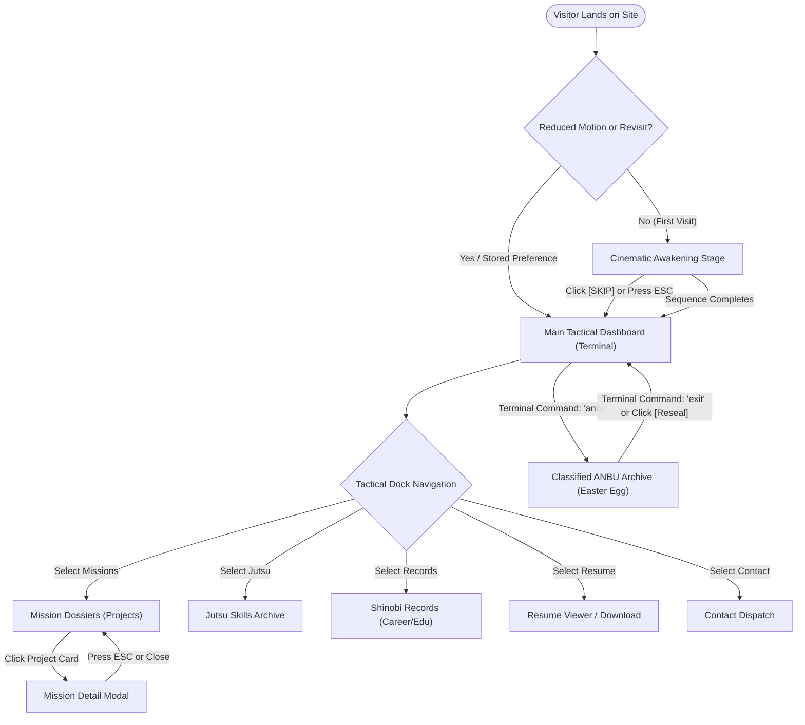
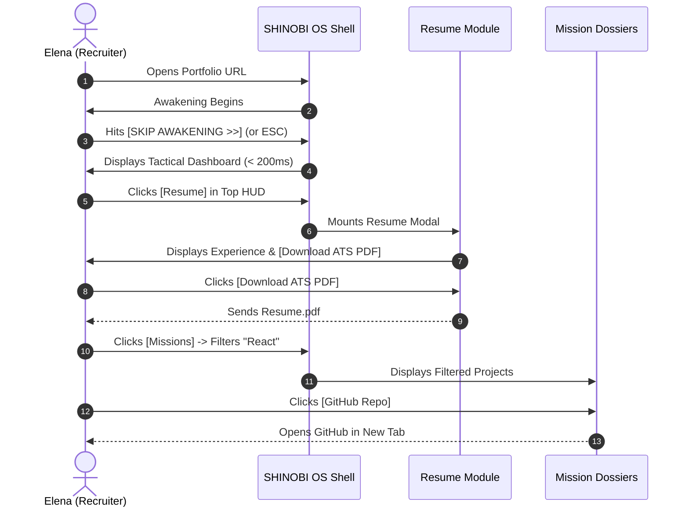
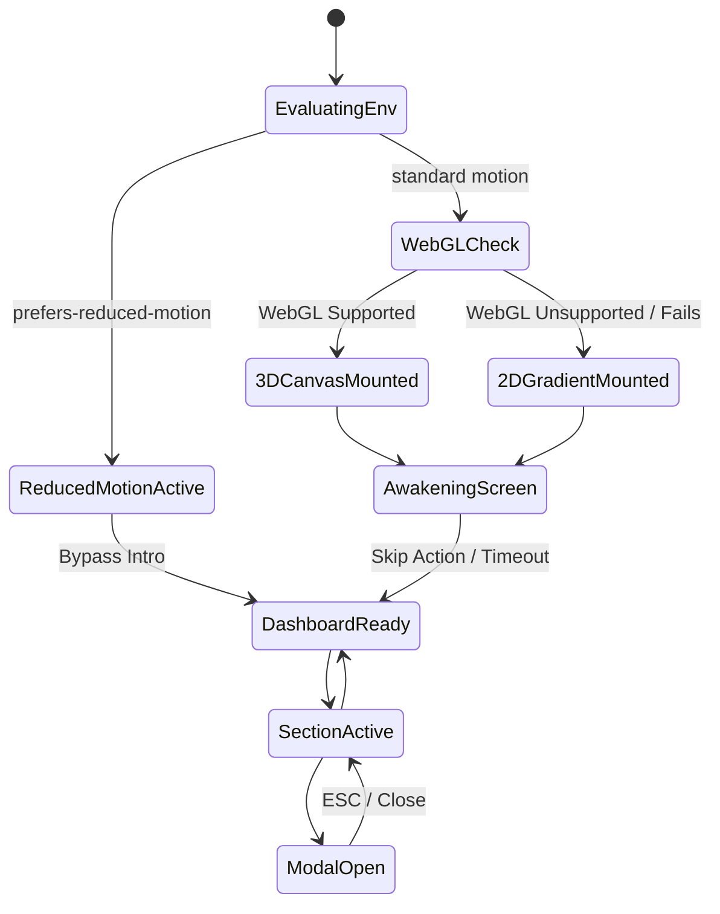
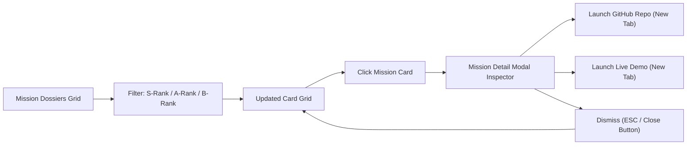

# Application Flow & Interaction Architecture Document
# SHINOBI OS — Classified Shinobi Intelligence

---

## 1. Document Metadata & Version

| Attribute | Details |
| :--- | :--- |
| **Document Title** | Application Flow & Interaction Architecture: SHINOBI OS |
| **Document ID** | APPFLOW-SHINOBI-001 |
| **Version** | 1.0.0 (Comprehensive Architecture Baseline) |
| **Status** | Approved for UX & Technical Architecture Review |
| **Last Updated** | 2026-10-10 |
| **Author** | Senior UX Architect & Interaction Designer |
| **Primary Reference** | `SHINOBI-OS/docs/PRD.md` (v1.0.0) |
| **Repository Path** | `SHINOBI-OS/docs/AppFlow.md` |

---

## 2. Information Architecture (IA)

SHINOBI OS organizes all content into a tactical, non-hierarchical hub where every major portfolio artifact is reachable in one click from the persistent **Tactical HUD Dock**.

```
[SHINOBI OS ROOT]
│
├── 0. AWAKENING STAGE (Overlay / First-Load Transition)
│   ├── Cinematic Chakra Initialization Sequence
│   ├── Skip Awakening Trigger [Escape / Click]
│   └── Replay Awakening Action (Accessible from HUD Menu)
│
├── 1. PERSISTENT TACTICAL HUD (Always Present Viewport Shell)
│   ├── Top Status Bar: Village Emblem, System Status, Audio Toggle [Mute/Unmute], Theme Accent
│   └── Bottom Tactical Dock: Terminal, Missions, Jutsu, Records, Resume, Contact
│
├── 2. PRIMARY APPLICATION VIEWS (Active Canvas State)
│   ├── View A: Tactical Terminal (Interactive Command Shell & System Log)
│   ├── View B: Mission Dossiers (Project Vault, Filter Tabs, Search Bar)
│   ├── View C: Jutsu Archive (Categorized Technical Skills & Proficiencies)
│   ├── View D: Shinobi Records (Career Experience Timeline, Academy Education, Achievements)
│   ├── View E: Contact Dispatch (Transmission Channels, Direct Email, Social Uplinks)
│   └── View F: Classified ANBU Archive (Optional Easter Egg Unsealed State)
│
└── 3. MODAL OVERLAYS & FLYOUT PANELS
    ├── Modal M1: Mission Detail Inspector (Full Architecture Specs, GitHub, Live Link)
    ├── Modal M2: Resume Reader / PDF Specimen Viewer
    ├── Modal M3: Contact Transmission Composer (Draft Mail Dispatch)
    └── Modal M4: Mobile Tactical Drawer (Touch Navigation Drawer on Viewports < 768px)
```

---

## 3. Global Experience Flow

```
[Visitor Navigates to Root URL]
          │
          ▼
   {Check Conditions}
   ├── prefers-reduced-motion? ──▶ YES ──▶ [Bypass Awakening directly to Dashboard]
   ├── Session skip flag set?   ──▶ YES ──▶ [Bypass Awakening directly to Dashboard]
   └── Direct deep-link URL?    ──▶ YES ──▶ [Bypass Awakening and mount target Section]
          │ (Default: Standard First Load)
          ▼
┌────────────────────────────────────────────────────────┐
│ 0. CINEMATIC AWAKENING STAGE                           │
│ • Dark ambient canvas fades up (#07080C)               │
│ • Telemetry cipher & Leaf seal sequence                │
│ • [SKIP AWAKENING >>] button visible at t=0            │
│ • Action: User clicks Skip or presses Escape/Space     │
└────────────────────────────────────────────────────────┘
          │
          ▼
┌────────────────────────────────────────────────────────┐
│ 1. MAIN TACTICAL HUD DASHBOARD                         │
│ • Tactical Terminal mounted as default centerpiece     │
│ • Persistent Top Status Bar + Bottom Tactical Dock     │
│ • Audio remains strictly MUTED by default              │
└────────────────────────────────────────────────────────┘
          │
          ├── [Click "Missions" / 'projects'] ──▶ View B: Mission Dossiers (Filter / Search)
          │                                              └── [Click Card] ──▶ Modal M1: Mission Detail
          ├── [Click "Jutsu" / 'skills']      ──▶ View C: Jutsu Skills Archive
          ├── [Click "Records" / 'experience']──▶ View D: Shinobi Career Timeline & Education
          ├── [Click "Resume" / 'resume']     ──▶ Modal M2 / Direct PDF Download
          ├── [Click "Contact" / 'contact']   ──▶ View E: Contact Dispatch Modal / Mailto
          └── [Terminal Input: 'anbu']        ──▶ View F: Classified ANBU Easter Egg
```

---

## 4. Screen-by-Screen Specifications

### 4.1 Screen S1: Cinematic Awakening (Boot Intro)
- **Purpose**: Establishes thematic immersion, visual polish, and artistic identity while respecting the visitor's time.
- **Entry Points**: First site visit on desktop/tablet without a stored skip cookie/preference; or explicit invocation of the `Replay Awakening` command.
- **Main Content**: Leaf Village digital cipher decoding, simulated chakra resonance frequency (`432 Hz`), clearance rank verification (`CLEARANCE: JOUNIN / RECRUITER ACCESS`).
- **Primary Action**: `[SKIP AWAKENING >>]` button (top-right fixed anchor).
- **Secondary Actions**: Pressing `Escape` or `Spacebar`; clicking anywhere on the background viewport.
- **Destination of Actions**: Instantly transitions to S2 (Main Terminal Dashboard) in $\le 200\text{ ms}$.
- **Back-Navigation**: N/A (root start state).
- **Loading / Transition**: CSS opacity fade with hardware-accelerated transform out.
- **Mobile Behavior**: Automatically abbreviated or skipped on mobile screens to prioritize fast data access.
- **Accessibility & Keyboard**:
  - Focus is placed immediately on the `[SKIP AWAKENING >>]` button.
  - Screen reader receives `aria-label="Skip introductory awakening sequence"`.
  - If `prefers-reduced-motion` is detected, this screen is bypassed entirely.

### 4.2 Screen S2: Main Shinobi Terminal Dashboard
- **Purpose**: The tactical command center and primary interaction shell of SHINOBI OS.
- **Entry Points**: Awakening completion, direct site entry, or clicking `Terminal` in the HUD dock.
- **Main Content**:
  - CRT-styled monospaced console window with minimize/maximize control deco.
  - System header: `SHINOBI OS [Tactical Intelligence Shell] // Village: Hidden Leaf`.
  - Dynamic prompt: `shinobi@leaf:~$` with blinking caret.
  - Output log stream showing command history and system responses.
- **Primary Action**: Command line input field for typing commands (`help`, `projects`, `skills`, `resume`, `contact`, `clear`).
- **Secondary Actions**: Clickable command shortcuts embedded in terminal output text (e.g. clicking `[projects]` executes `projects`).
- **Destination of Actions**: Executes command inline, prints output to the terminal log, or switches the active viewport pane.
- **Back-Navigation**: Clears command with `Ctrl+C` or `Escape`; history navigation with `ArrowUp` / `ArrowDown`.
- **Loading / Transition**: Terminal maintains state in memory; switching tabs preserves command history.
- **Mobile Behavior**: Displays a compact, touch-friendly command bar with quick-tap pills for `help`, `projects`, `skills`, `resume`.
- **Accessibility & Keyboard**:
  - Terminal log is marked with `role="log"` and `aria-live="polite"`.
  - Full keyboard focus trap prevention: `Tab` navigates out of the terminal input to the HUD dock if desired.

### 4.3 Screen S3: Mission Dossiers (Projects Showcase)
- **Purpose**: Comprehensive showcase of engineering projects, code repositories, and live applications.
- **Entry Points**: Clicking `Missions` in the Tactical Dock; terminal command `projects` or `ls missions/`; URL deep-link `#missions`.
- **Main Content**:
  - Filter Bar: Category tabs (`All`, `S-Rank (Flagship)`, `A-Rank (Systems)`, `B-Rank (Tools)`).
  - Search Input: Instant text search across project titles and tech stacks.
  - Responsive Grid of Mission Cards: Each displaying Title, Mission Rank badge, Summary, Tech Stack tags, GitHub icon, and Live Demo icon.
- **Primary Action**: Click on any Mission Card to open S4 (Individual Mission Detail Modal).
- **Secondary Actions**: Click `[GitHub Repo]` (opens repo in new tab); click `[Live Demo]` (opens deployment in new tab).
- **Destination of Actions**: Modal S4 or external URL.
- **Back-Navigation**: Returns to S2 (Terminal) via HUD Dock or back button.
- **Loading / Transition**: Staggered fade-up animation for cards (disabled if reduced-motion active).
- **Mobile Behavior**: Single-column vertical scroll with sticky category filter pills.
- **Accessibility & Keyboard**:
  - Each card is a keyboard-focusable article (`role="article"` or interactive button).
  - External links feature `aria-label="View source code on GitHub (opens in new tab)"` and `rel="noopener noreferrer"`.

### 4.4 Screen S4: Individual Mission Detail (Modal Inspector)
- **Purpose**: In-depth architectural case study and inspection of a specific software project.
- **Entry Points**: Clicking a Mission Card in S3; terminal command `cat missions/<project-slug>`.
- **Main Content**:
  - Header: Mission Rank, Codename, Official Project Title, Status.
  - Architecture Breakdown: Problem solved, technical architecture, key challenges, engineering decisions.
  - System Telemetry Strip: Key metrics, performance stats, test coverage notes.
  - Technology Stack Chips: Every library, framework, database, and tool used.
  - Action Controls: `[Open GitHub Repository]`, `[Launch Live Deployment]`, `[Close Modal]`.
- **Primary Action**: `[Close / Dismiss]` button or `Escape` key.
- **Secondary Actions**: External link buttons.
- **Destination of Actions**: Dismissing returns focus to the origin card in S3.
- **Back-Navigation**: Pressing browser back button or `Escape` closes the modal.
- **Loading / Transition**: Smooth centered backdrop fade with modal scale transition.
- **Mobile Behavior**: Full-screen overlay with sticky header and bottom action bar.
- **Accessibility & Keyboard**:
  - Implements WAI-ARIA Dialog pattern (`role="dialog"`, `aria-modal="true"`, `aria-labelledby`).
  - Focus is trapped within modal while open; restored to trigger element on close.
  - Pressing `Escape` instantly dismisses modal.

### 4.5 Screen S5: Jutsu Archive (Technical Skills)
- **Purpose**: Structured directory of technical proficiencies categorized by engineering domain.
- **Entry Points**: Clicking `Jutsu` in the Tactical Dock; terminal command `skills` or `cat jutsu/`; URL deep-link `#skills`.
- **Main Content**:
  - 4 Discipline Quadrants:
    1. *Ninjutsu (Frontend & UI Engineering)*
    2. *Taijutsu (Backend, Languages & Systems)*
    3. *Fuinjutsu (DevOps, Security, Cloud & Infrastructure)*
    4. *Genjutsu (Creative Tech, Canvas, 3D & Design)*
  - Each skill card displays: Real-world technology title, proficiency tier (`Production Core`, `Proficient`, `Familiar`), and icon.
- **Primary Action**: Hovering or clicking a skill highlights associated projects in S3.
- **Secondary Actions**: Filter by discipline.
- **Destination of Actions**: Contextual tooltips or quick-filter transitions to S3.
- **Back-Navigation**: Returns to S2 (Terminal) or previous view via HUD Dock.
- **Loading / Transition**: Clean grid layout with CSS grid transitions.
- **Mobile Behavior**: 2-column or 1-column accordion layout with collapsible discipline sections.
- **Accessibility & Keyboard**:
  - Tab order traverses through disciplines and skills logically.
  - Skill badges include explicit textual proficiency levels for screen readers.

### 4.6 Screen S6: Shinobi Records (Experience & Education)
- **Purpose**: Verified timeline of professional employment, software roles, education, and credentials.
- **Entry Points**: Clicking `Records` in HUD Dock; terminal command `cat records/` or `experience`; deep-link `#records`.
- **Main Content**:
  - Chronological Career Timeline: Organization/company name, role title, period, core accomplishments.
  - Academy Education Section: Academic institution, degree, relevant coursework.
  - Certifications & Honors: Verified technical credentials.
- **Primary Action**: `[Download Complete Resume PDF]` button.
- **Secondary Actions**: Expanding individual timeline entries for detailed accomplishment bullets.
- **Destination of Actions**: Triggers resume download or in-browser viewer.
- **Back-Navigation**: Switch to other sections via HUD Dock.
- **Mobile Behavior**: Linear vertical timeline with touch-friendly accordion cards.
- **Accessibility & Keyboard**: Semantic `<ol>` timeline markup with accessible headings (`<h3>`, `<h4>`).

### 4.7 Screen S7: Resume Access (PDF Specimen Viewer)
- **Purpose**: Fast-track access to the developer's formal, ATS-friendly resume for recruiters.
- **Entry Points**: Persistent `Resume` button in Top HUD bar; `Resume` item in Dock; terminal command `resume`.
- **Main Content**:
  - Clean preview frame or downloadable PDF action modal.
  - Key quick-copy data: Email, LinkedIn, Core Stack, Current Availability.
  - Direct download button: `[Download ATS Resume PDF]`.
- **Primary Action**: Direct download of PDF.
- **Secondary Actions**: `[Print Resume]`, `[Open in New Tab]`, `[Copy Contact Info]`.
- **Destination of Actions**: File download or browser print dialog.
- **Back-Navigation**: Returns to previous screen via `Escape` or Close button.
- **Accessibility & Keyboard**: Accessible button triggers with direct `<a href="..." download>` fallback.

### 4.8 Screen S8: Contact Dispatch
- **Purpose**: Transmission channels allowing visitors to reach the developer directly.
- **Entry Points**: Clicking `Contact` in HUD Dock; terminal command `contact`; deep-link `#contact`.
- **Main Content**:
  - Direct Email Display with `[Copy to Clipboard]` button.
  - External links: GitHub Profile, LinkedIn Profile, X/Twitter.
  - Quick Transmission Form: Name, Email, Message fields with `[Transmit Message]` button.
- **Primary Action**: Click email link (`mailto:`) or submit message.
- **Secondary Action**: Click copy button with visual checkmark feedback (`"Copied to clipboard!"`).
- **Destination of Actions**: Launches default mail client or displays submission confirmation.
- **Back-Navigation**: Closes modal or navigates back to terminal via HUD Dock.
- **Accessibility & Keyboard**:
  - Fully accessible `<form>` with associated `<label>` tags.
  - Validation errors announced via `aria-describedby` and `aria-invalid`.

### 4.9 Screen S9: Optional ANBU Classified Experience (Easter Egg)
- **Purpose**: Playful interactive secret for anime fans and curious developers; unlocks classified engineering lore.
- **Entry Points**: Typing `anbu`, `sharingan`, or `seal:open` into the terminal; triple-clicking the Leaf Village emblem.
- **Main Content**:
  - Visual theme glitch shift: Obsidian slate shifts to Crimson Katana neon accents (`#E11D48`).
  - ANBU Black-Ops dossier unsealed: "Classified Mission #007: The Will of Fire Architecture Post-Mortem".
  - Audio FX: Subtle low-frequency digital pulse (if audio enabled).
- **Primary Action**: `[Reseal Archive / Return to Civilian Mode]` button.
- **Secondary Actions**: Read secret developer manifesto; type `exit` in terminal.
- **Destination of Actions**: Restores standard HUD and terminal theme instantly.
- **Back-Navigation**: Pressing `Escape` or clicking `[Reseal]` restores standard UI state.
- **Accessibility & Keyboard**:
  - No essential portfolio information is exclusive to this screen (per PRD FR-026).
  - Color contrast in ANBU mode maintains WCAG 2.1 AA ($\ge 4.5:1$).

### 4.10 State Screen S10: Loading, Error, Empty & Unsupported-3D States
- **Loading State**: Subtle pulsating Leaf-green beacon with text `"SYNCHRONIZING CHAKRA TELEMETRY..."`.
- **Empty State (Filter/Search)**: When no projects match a query: Displays `"NO MISSIONS LOCATED IN ARCHIVE. Enter 'projects' or reset filters."` with a prominent `[Reset Filters]` button.
- **Error State**: Non-blocking banner: `"TRANSMISSION INTERRUPTED. System operating in offline cache mode."` with a `[Retry]` action.
- **Unsupported-3D / WebGL Fallback**: When WebGL fails or is disabled: Renders an elegant 2D procedural gradient mesh with subtle vignette; 0% performance degradation, 100% functionality preserved.

---

## 5. Navigation Model

### 5.1 Primary Navigation: Persistent Tactical HUD Dock
The primary navigation is anchored at the bottom of the viewport on desktop and as a sticky dock/drawer on mobile:

| Dock Item | Key Shortcut | Terminal Command | Action / Target View |
| :--- | :--- | :--- | :--- |
| **Terminal** | `Alt + 1` | `terminal` / `clear` | Mounts S2 (Shinobi Terminal) |
| **Missions** | `Alt + 2` | `projects` / `ls missions` | Mounts S3 (Mission Dossiers) |
| **Jutsu** | `Alt + 3` | `skills` / `cat jutsu` | Mounts S5 (Jutsu Archive) |
| **Records** | `Alt + 4` | `experience` / `records` | Mounts S6 (Career & Education) |
| **Resume** | `Alt + 5` | `resume` | Opens S7 (Resume Modal / Download) |
| **Contact** | `Alt + 6` | `contact` | Opens S8 (Contact Dispatch) |

### 5.2 Section Switching Paradigm
- Switching sections switches the active viewport stage with an instantaneous cross-fade transition ($\le 150\text{ ms}$).
- The Tactical Terminal retains its state, command history, and buffer when switching back and forth.
- Users can navigate entirely via GUI clicks or entirely via the terminal command line.

### 5.3 URL & Deep-Link Strategy
To ensure recruiters and external links can navigate directly to specific sections without forcing intro playback, SHINOBI OS implements a clean hash-based deep linking model:

| URL Route | Destination Screen | Intro Behavior |
| :--- | :--- | :--- |
| `/` | S1 (Awakening) on 1st visit, S2 (Terminal) on revisit | Standard |
| `/#terminal` | S2 (Terminal Dashboard) | Intro automatically bypassed |
| `/#missions` | S3 (Mission Dossiers) | Intro automatically bypassed |
| `/#missions/:slug` | S4 (Mission Detail Modal over S3) | Intro automatically bypassed |
| `/#jutsu` | S5 (Jutsu Skills Archive) | Intro automatically bypassed |
| `/#records` | S6 (Career & Education Records) | Intro automatically bypassed |
| `/#resume` | S7 (Resume Viewer / Download) | Intro automatically bypassed |
| `/#contact` | S8 (Contact Dispatch) | Intro automatically bypassed |

*Note: Hash-based routing (`/#route`) is recommended for static edge CDNs (GitHub Pages, static Vercel) to avoid 404 rewriting issues without complex server redirect rules.*

### 5.4 Browser History & Back/Forward Support
- Navigating between sections via dock or terminal pushes/replaces state in browser history via `window.history.pushState`.
- Clicking the browser's Back button returns to the previously active section.
- If a modal (Mission Detail S4 or Resume S7) is open, pressing Back dismisses the modal first before changing the underlying section.

### 5.5 Intro Skip & Replay Model
- **Skip Persistence**: Once skipped, `localStorage.setItem('shinobi_intro_seen', 'true')` ensures returning visits load straight to S2.
- **Replay Action**: Visitors can re-experience the awakening at any time via:
  1. Top HUD system menu action: `[Replay Awakening]`.
  2. Terminal command: `awakening --replay` or `boot`.

---

## 6. Step-by-Step User Journeys

### Journey 1: The Recruiter Fast-Track (Duration: $\le 20$ seconds)
1. **Starting State**: Elena clicks portfolio link from an email or LinkedIn.
2. **Action 1**: Landing page begins awakening sequence. Elena immediately clicks `[SKIP AWAKENING >>]` (or hits `Esc`).
3. **Expected Result**: Awakening sequence halts; HUD Dashboard mounts instantly.
4. **Action 2**: Elena clicks the glowing `[Resume]` button in the top HUD.
5. **Expected Result**: Resume modal opens with verified experience summary, tech stack chips, and `[Download ATS PDF]` button.
6. **Action 3**: Elena clicks `[Download ATS PDF]`. File downloads immediately.
7. **Action 4**: Elena clicks `[Missions]` in dock, filters by `React`, and clicks `[GitHub]` on the flagship project.
8. **Recovery Path**: If PDF download is blocked by browser popup blockers, an in-browser readable preview modal displays the resume text and direct raw link.

### Journey 2: Developer Inspecting a Project (Duration: 1–3 minutes)
1. **Starting State**: Daisuke lands on dashboard.
2. **Action 1**: Clicks `[Missions]` in the dock.
3. **Action 2**: Types `"TypeScript"` in the filter search box. Cards filter in real time ($< 16\text{ ms}$).
4. **Action 3**: Clicks on an S-Rank Flagship Mission Card.
5. **Expected Result**: Modal S4 opens showing system architecture, state management breakdown, performance metrics, and live URL.
6. **Action 4**: Daisuke clicks `[View GitHub Repository]`. GitHub opens in a new secure tab (`rel="noopener noreferrer"`).
7. **Action 5**: Daisuke presses `Escape`. Modal closes; focus returns smoothly to the origin card.
8. **Recovery Path**: If live demo server is temporarily asleep, the modal highlights the source code repository as the primary reference.

### Journey 3: Visitor Exploring Technical Skills (Duration: 1–2 minutes)
1. **Starting State**: Visitor is on the main terminal dashboard.
2. **Action 1**: Types `skills` into the terminal and presses `Enter`.
3. **Expected Result**: Terminal prints formatted summary of Ninjutsu, Taijutsu, Fuinjutsu, and Genjutsu disciplines, with a clickable link: `[Open Interactive Jutsu Archive]`.
4. **Action 2**: Clicks link or clicks `[Jutsu]` in dock.
5. **Expected Result**: S5 (Jutsu Archive) mounts, revealing skill quadrants, proficiency tags, and tech stack chips.
6. **Recovery Path**: If terminal input has a typo (`skils`), the system suggests: `"Did you mean 'skills'? Enter 'help' for valid chakra scrolls."`

### Journey 4: Visitor Accessing the Resume (Duration: $\le 10$ seconds)
1. **Starting State**: Any screen or view.
2. **Action 1**: Presses shortcut `Alt + 5` or clicks `Resume` in HUD.
3. **Expected Result**: S7 (Resume Modal) mounts over current view without reloading.
4. **Action 2**: Clicks `[Download PDF]`.
5. **Expected Result**: Browser prompts download of `Developer_Resume.pdf`.

### Journey 5: Visitor Contacting the Developer (Duration: 1 minute)
1. **Starting State**: Visitor is reviewing a project in S3.
2. **Action 1**: Clicks `[Contact]` in HUD dock.
3. **Expected Result**: S8 (Contact Dispatch Modal) opens.
4. **Action 2**: Clicks `[Copy Email Address]`.
5. **Expected Result**: Text copied to clipboard; button transforms into a green checkmark with label `"Copied to Clipboard!"` for 2.5 seconds.
6. **Action 3**: Visitor clicks `[Send via Mail Client]`. Default OS email client opens with `mailto:` link.
7. **Recovery Path**: If clipboard API is restricted by browser security, the email address is highlighted inside an accessible text field for standard `Ctrl+C` copying.

### Journey 6: Mobile Visitor Navigating the Website (Duration: 1–2 minutes)
1. **Starting State**: Visitor opens site on mobile smartphone ($375\text{px}$ viewport).
2. **Action 1**: Site loads; awakening is automatically streamlined with an instant `"ENTER SHINOBI OS"` touch button.
3. **Action 2**: Main mobile interface displays a clean vertical stack with sticky bottom thumb navigation.
4. **Action 3**: Taps `Missions` tab in bottom dock. Cards render in a smooth full-width card feed.
5. **Action 4**: Taps a card. Full-screen drawer slides up with complete details and high touch-target buttons ($\ge 44\text{px}$).
6. **Action 5**: Swipes down or taps `[✕]` to close drawer.
7. **Recovery Path**: If phone orientation rotates to landscape, layout adapts dynamically without resetting scroll position.

### Journey 7: Visitor with Reduced-Motion or No WebGL (Duration: 1 minute)
1. **Starting State**: User has OS setting `prefers-reduced-motion: reduce` enabled, or visits from a VM without hardware WebGL.
2. **Expected Result**: Awakening animations, 3D particle drift, and scanline blinks are disabled. Screen renders high-contrast, static 2D slate canvas with instantaneous view transitions.
3. **Action**: User navigates between sections via dock or keyboard.
4. **Expected Result**: All content, project descriptions, skills, and resume downloads function with 100% parity.

### Journey 8: Curious Visitor Discovering the ANBU Easter Egg (Duration: 2 minutes)
1. **Starting State**: Visitor is in the Shinobi Terminal (S2).
2. **Action 1**: Types `anbu` or `sharingan` into prompt and hits `Enter`.
3. **Expected Result**: Audio chime sounds (if audio unmuted); viewport accents flash Crimson Katana (`#E11D48`); classified ANBU dossier unseals in terminal log with special engineering case study.
4. **Action 2**: Visitor finishes reading and types `exit` or clicks `[Reseal Archive]`.
5. **Expected Result**: Standard Leaf-green and onyx theme is restored instantly.
6. **Recovery Path**: If visitor types an invalid secret command, normal terminal error message is returned with zero disruption to standard navigation.

---

## 7. Interaction Specifications

```
┌────────────────────────────────────────────────────────┐
│ COMPONENT INTERACTION MATRIX                           │
├────────────────────┬───────────────────────────────────┤
│ Element            │ Default / Hover / Active Behavior │
├────────────────────┼───────────────────────────────────┤
│ HUD Dock Items     │ Def: Muted slate | Hvr: Leaf-green│
│                    │ Act: Glow border + Underline pill │
│ Filter Tabs        │ Def: Ghost border | Hvr: Light up │
│                    │ Act: Solid accent background      │
│ Mission Cards      │ Def: Slate-dark border            │
│                    │ Hvr: Translate Y -3px, glow border│
│ Modals             │ Open: Scale 0.95 -> 1.0, fade in  │
│                    │ Close: Scale 1.0 -> 0.95, fade out│
│ Audio Toggle       │ Def: Muted icon [🔇]               │
│                    │ Click: Toggles sound FX [🔊]      │
│ Tooltips           │ 300ms hover delay, non-blocking   │
└────────────────────┴───────────────────────────────────┘
```

- **HUD Dock Buttons**:
  - Hover: Subtle green glow (`box-shadow: 0 0 12px rgba(16,185,129,0.25)`), font color shifts to `#F1F5F9`.
  - Active: Persistent green indicator pip below the active icon.
  - Keyboard Focus: Visible double-ring focus indicator (`outline: 2px solid #10B981`, `outline-offset: 2px`).
- **Project Filter Tabs**:
  - Instant client-side state update; cards rearrange via fluid FLIP layout transitions.
- **Mission Cards**:
  - Hover: Elevation lift ($-3\text{px}$ transform), border color shifts from `#1E2638` to `#10B981`.
  - Touch: Immediate visual feedback on `touchstart` without 300ms tap delay.
- **Modals & Overlays**:
  - Trap focus within modal while open.
  - Clicking outside modal backdrop or pressing `Escape` dismisses the modal.
  - Body scroll is locked while modal is active.
- **Audio Feedback**:
  - Disabled by default. Clicking the audio toggle initializes Web Audio API context.
  - Provides subtle, low-volume ($< 20\text{dB}$) synthesized clicks on navigation triggers.

---

## 8. State & Transition Model

### 8.1 Finite State Machine (UI States)

| State Key | Description | Allowed Next States |
| :--- | :--- | :--- |
| `STATE_INIT` | Initial page script evaluation | `STATE_AWAKENING`, `STATE_DASHBOARD` |
| `STATE_AWAKENING` | Cinematic boot sequence active | `STATE_DASHBOARD` |
| `STATE_DASHBOARD` | Terminal / Central HUD active | `STATE_SECTION_ACTIVE`, `STATE_MODAL_OPEN`, `STATE_ANBU` |
| `STATE_SECTION_ACTIVE`| Missions, Jutsu, or Records active | `STATE_DASHBOARD`, `STATE_MODAL_OPEN` |
| `STATE_MODAL_OPEN` | Mission Detail or Resume modal active | `STATE_SECTION_ACTIVE`, `STATE_DASHBOARD` |
| `STATE_ANBU` | Classified Easter egg active | `STATE_DASHBOARD` |
| `STATE_REDUCED_MOTION`| System operating with static transitions| Same as above (animations disabled) |
| `STATE_2D_FALLBACK` | System operating without WebGL | Same as above (2D gradient active) |

### 8.2 State Recovery Rules
- If an unhandled error occurs during a view transition, the system resets to `STATE_DASHBOARD` and logs a non-intrusive warning to the terminal.
- If a modal state is corrupted, pressing `Escape` purges all open modal flags and returns focus to the main container.

---

## 9. URL & Deep-Link Plan

- **Routing Paradigm**: Hash-based client routing (`/#section`) to ensure 100% compatibility with static GitHub Pages, Vercel, and Netlify edge hosting without URL rewrite configuration.
- **Directly Linkable Targets**:
  - `/#terminal` $\rightarrow$ Mounts Terminal Dashboard.
  - `/#missions` $\rightarrow$ Mounts Mission Dossiers view.
  - `/#missions/:slug` $\rightarrow$ Mounts Mission Dossiers view and opens specific project modal.
  - `/#jutsu` $\rightarrow$ Mounts Jutsu Technical Skills archive.
  - `/#records` $\rightarrow$ Mounts Shinobi Career & Education records.
  - `/#resume` $\rightarrow$ Directly triggers the Resume viewer.
  - `/#contact` $\rightarrow$ Mounts Contact Dispatch modal.
- **Status**: *Confirmed recommendation; implementation details to be finalized in `TRD.md`.*

---

## 10. Responsive Adaptation Flow

```
Desktop (≥ 1024px)          Tablet (768px - 1023px)         Mobile (< 768px)
┌───────────────────────┐   ┌───────────────────────┐      ┌───────────────────────┐
│ [Top HUD Status Bar]  │   │ [Top HUD Status Bar]  │      │ [Compact Top Bar]     │
├───────────────────────┤   ├───────────────────────┤      ├───────────────────────┤
│ Multi-column layout   │   │ 2-column grid layout  │      │ Single-column stream  │
│ Terminal + Side Panes │   │ Terminal expandable   │      │ Terminal command pill │
│ Floating Modals       │   │ Adaptive cards        │      │ Full-screen drawers   │
├───────────────────────┤   ├───────────────────────┤      ├───────────────────────┤
│ [Bottom Tactical Dock]│   │ [Bottom Tactical Dock]│      │ [Sticky Bottom Nav]   │
└───────────────────────┘   └───────────────────────┘      └───────────────────────┘
```

- **Desktop ($\ge 1024\text{px}$)**: Full HUD interface with wide 3-column project cards, side-by-side terminal logs, and interactive 3D chakra particle canvas.
- **Tablet ($768\text{px} - 1023\text{px}$)**: 2-column project cards, collapsible sidebar panes, full touch-gesture support for scroll inspection.
- **Mobile ($< 768\text{px}$)**:
  - Awakening sequence auto-shortened with single-tap skip.
  - Single-column cards with $48\text{px}$ minimum touch targets.
  - Sticky bottom navigation bar with thumb-accessible icons.
  - Modals adapt into bottom-sheet sliding drawers with swipe-to-dismiss gesture.

---

## 11. Accessibility Flow (A11Y)

1. **Logical Tab Order**:
   - `Skip to Main Content` link $\rightarrow$ Top Status Bar (Audio Toggle, Theme) $\rightarrow$ Active Stage Content (Inputs, Cards, Buttons) $\rightarrow$ Bottom Tactical Dock.
2. **Keyboard Traps & Modal Containment**:
   - When a modal (Mission Detail, Resume, Contact) opens, keyboard focus is automatically trapped within the modal container.
   - Pressing `Tab` on the last modal element wraps around to the close button.
   - Pressing `Escape` closes the modal immediately and returns focus to the button that triggered it.
3. **Screen Reader Live Regions**:
   - Terminal command outputs utilize `aria-live="polite"` so screen reader users hear output without page interruptions.
   - Project filter count updates are announced (`"Filtered to 4 S-Rank missions"`).
4. **Motion Inclusivity**:
   - All animations query `window.matchMedia('(prefers-reduced-motion: reduce)')`. When active, CSS duration tokens are clamped to `0.01ms`.

---

## 12. Flow Diagrams (Mermaid)

### 12.1 Overall Application Navigation


### 12.2 Recruiter Fast-Track Journey


### 12.3 Intro & Fallback State Machine


### 12.4 Mission Dossier Navigation Flow


---

## 13. Edge Cases & Recovery Paths

| Edge Case Scenario | UX Failure Mode | Recovery Path & System Handling |
| :--- | :--- | :--- |
| **Direct URL to Non-Existent Mission** (`/#missions/unknown-slug`) | Page cannot find matching mission data | Displays a friendly in-app notification: `"Mission Dossier not found in Leaf archives."` and redirects safely to `/#missions` root. |
| **Browser Refresh Mid-Modal** | Modal state may reset | URL reflects hash `/#missions/:slug`; on refresh, system mounts the mission view and re-opens the target modal directly. |
| **External Project Demo Link Down** | 404 or server timeout on external demo site | Mission modal prominently highlights the verified GitHub Source Repository as the primary artifact alongside the demo link. |
| **WebGL Context Loss Mid-Session** | Canvas turns blank or throws WebGL error | Global `webglcontextlost` listener captures event, unmounts 3D canvas, and replaces it with the procedural 2D CSS mesh gradient seamlessly. |
| **Offline / Network Interruption** | Static fonts or audio fail to fetch | System uses native system monospace font stack (`ui-monospace`, `Courier New`) and continues audio-free without blocking UI rendering. |
| **Rapid Tapping on Mobile Nav** | Race condition in view transitions | UI updates are debounced ($100\text{ms}$ throttle); concurrent transition hooks safely cancel intermediate animations. |

---

## 14. PRD Traceability Matrix

| AppFlow Screen / Flow | Primary Requirement IDs in `docs/PRD.md` |
| :--- | :--- |
| **Awakening & Skip Intro (S1)** | `FR-001`, `FR-002`, `FR-003`, `FR-004`, `NFR-007` |
| **Shinobi Terminal Dashboard (S2)** | `FR-005`, `FR-006`, `FR-007`, `FR-008`, `FR-009`, `FR-010` |
| **Mission Dossiers & Filtering (S3)** | `FR-011`, `FR-012`, `FR-013`, `FR-014`, `NFR-011` |
| **Mission Detail Inspector (S4)** | `FR-015`, `FR-030`, `NFR-006`, `NFR-011` |
| **Jutsu Technical Skills (S5)** | `FR-016`, `FR-017`, `FR-018`, `FR-019` |
| **Career & Education Records (S6)**| `FR-020`, `FR-021`, `FR-022`, `FR-023` |
| **Resume Access & Download (S7)** | `FR-022`, `FR-023`, `NFR-001` |
| **Contact Dispatch (S8)** | `FR-028`, `FR-029`, `FR-030`, `NFR-010` |
| **ANBU Easter Egg Archive (S9)** | `FR-024`, `FR-025`, `FR-026` |
| **HUD Dock Navigation** | `FR-027`, `FR-030`, `NFR-006`, `NFR-012` |
| **Audio Controls** | `FR-031`, `FR-032`, `FR-033` |
| **Accessibility & Fallback Flows** | `NFR-005`, `NFR-006`, `NFR-007`, `NFR-008`, `NFR-015` |

---

## 15. Open Decisions & Downstream Specifications

The following UX and interaction nuances are flagged for finalization in subsequent documentation:

1. **Modal Presentation Format on Mobile Viewports** *(To be finalized in `Design.md`)*:
   - *Recommendation*: Use bottom-sheet drawers that slide up from the viewport bottom on screens $< 768\text{px}$, allowing natural thumb dismissal.
2. **Contact Dispatch Form vs. Direct Client Action** *(To be finalized in `Design.md` & `TRD.md`)*:
   - *Recommendation*: Provide a direct one-click `[Copy Email]` and `[Open Mail Client]` button as the primary conversion path, with an optional static form modal as a secondary option.
3. **Sound FX Library Implementation** *(To be finalized in `AssetManifest.md` & `TRD.md`)*:
   - *Recommendation*: Utilize Web Audio API algorithmic oscillator synthesis for keyclicks to achieve 0-byte asset overhead.

---
*End of Application Flow & Interaction Architecture Document — SHINOBI OS*
