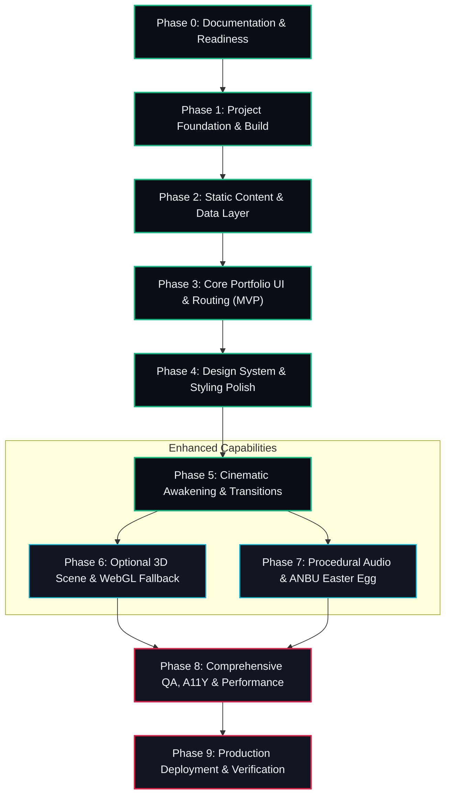

# Comprehensive Implementation Plan & Delivery Roadmap
# SHINOBI OS — Classified Shinobi Intelligence

---

## 1. Document Metadata & Context

| Attribute | Details |
| :--- | :--- |
| **Document Title** | Implementation Plan & Delivery Roadmap: SHINOBI OS |
| **Document ID** | PLAN-SHINOBI-001 |
| **Version** | 1.0.0 (Execution Baseline Specification) |
| **Status** | Approved for Development Staging |
| **Last Updated** | 2026-10-10 |
| **Author** | Senior Engineering Lead & Delivery Planner |
| **Primary References** | `SHINOBI-OS/docs/PRD.md` (v1.0.0), `SHINOBI-OS/docs/AppFlow.md` (v1.0.0), `SHINOBI-OS/docs/Design.md` (v1.0.0), `SHINOBI-OS/docs/Schema.md` (v1.0.0), `SHINOBI-OS/docs/TRD.md` (v1.0.0), `SHINOBI-OS/docs/AssetManifest.md` (v1.0.0) |
| **Repository Path** | `SHINOBI-OS/docs/ImplementationPlan.md` |

---

## 2. Delivery Strategy & Phased Execution Principles

### 2.1 Incremental Delivery Philosophy
SHINOBI OS follows an **"Inside-Out / Core-First"** implementation strategy. The professional portfolio capabilities must achieve 100% functional stability and accessibility *before* layering on cinematic animations or WebGL 3D environments.

```
┌────────────────────────────────────────────────────────────────────────┐
│                        DELIVERY HORIZONS                               │
├────────────────────────────────────────────────────────────────────────┤
│ HORIZON 1: Working Core Portfolio (MVP)                                │
│ • Static Typed Content Layer (Projects, Skills, History, Resume)       │
│ • Hash-based Router & Navigation Shell                                 │
│ • Full Keyboard Accessibility, WCAG 2.2 AA Contrast & Responsive Grid  │
│ • 100% functional without 3D, animations, or WebGL                    │
├────────────────────────────────────────────────────────────────────────┤
│ HORIZON 2: Cinematic Design & Interaction System                       │
│ • Design tokens & component state transitions                          │
│ • Cinematic Awakening Bootloader with instant skip controls            │
│ • Tactical Terminal Shell & Command Parser                             │
├────────────────────────────────────────────────────────────────────────┤
│ HORIZON 3: Atmospheric 3D & Advanced Refinements                      │
│ • Lazy-loaded React Three Fiber scene & particle foliage               │
│ • Automated 2D CSS mesh fallback for mobile & non-WebGL devices        │
│ • Web Audio API procedural sound synthesis                             │
│ • Optional ANBU Classified Easter Egg Archive                          │
├────────────────────────────────────────────────────────────────────────┤
│ HORIZON 4: Production Hardening & Static Deployment                   │
│ • Automated schema validation & end-to-end user journeys               │
│ • Lighthouse Performance (≥ 90) & Core Web Vitals optimization         │
│ • Production release to static edge CDN (Vercel / GitHub Pages)        │
└────────────────────────────────────────────────────────────────────────┘
```

### 2.2 Golden Rules of Execution
1. **Never Break Working Software**: Every phase must leave the repository in a clean, buildable, deployable state.
2. **Strict Scope Discipline**: Work strictly within the approved task scope; never generate speculative features or unrequested dependencies.
3. **Evidence-Based Verification**: No task is marked complete without running a real build (`npm run build`), type check (`tsc`), or test execution.

---

## 3. Implementation Phases Overview

| Phase ID | Phase Name | Primary Objective | Pre-requisites | Output Deliverable | Quality Gate |
| :--- | :--- | :--- | :--- | :--- | :--- |
| **Phase 0** | Documentation & Readiness | Align specifications & resolve blocking decisions | PRD, AppFlow, Design, Schema, TRD | Finalized docs suite | Gate 0: Spec Integrity |
| **Phase 1** | Project Foundation | Establish build tools, Tailwind v4, linting & minimal shell | Phase 0 | Clean Vite/React 19 foundation | Gate 1: Foundation Clean |
| **Phase 2** | Content & Data Layer | Implement static typed datasets & validation helpers | Phase 1 | `src/data/` datasets & schemas | Gate 2: Content Typed |
| **Phase 3** | Core Portfolio Views | Build terminal, missions, skills, timeline, resume, contact | Phase 2 | Functional non-3D portfolio | Gate 3: MVP Functional |
| **Phase 4** | Design System & UI | Apply design tokens, component states, and responsive styling | Phase 3 | Polished tactical UI | Gate 4: Design Complete |
| **Phase 5** | Cinematic Awakening | Implement bootloader, skip logic, and section transitions | Phase 4 | Awakening intro & skip flow | Gate 5: Intro Resilient |
| **Phase 6** | 3D Scene & Fallback | Add lazy R3F village atmosphere & 2D fallback | Phase 5 | Optional 3D canvas | Gate 6: WebGL Resilient |
| **Phase 7** | Audio & Easter Egg | Web Audio procedural synthesizer & ANBU Easter egg | Phase 6 | Audio & classified mode | Gate 7: Feature Complete |
| **Phase 8** | QA & Performance | Performance audits, a11y review, and test suites | Phase 7 | Zero regressions, Lighthouse $\ge 90$ | Gate 8: Release Ready |
| **Phase 9** | Deployment & Release | Edge CDN deployment, link audits, and production sign-off | Phase 8 | Live public deployment | Gate 9: Live Verified |

---

## 4. Task Dependency Graph (Mermaid)



---

## 5. Detailed Task-Level Breakdown

### Phase 0 — Documentation & Project Readiness
- **IMP-001** *(Priority: Must | Prereq: None)*: Cross-audit `PRD.md`, `AppFlow.md`, `Design.md`, `Schema.md`, `TRD.md`, and `AssetManifest.md` to ensure zero internal contradictions.
  - *Expected Output*: Clean, synchronized documentation baseline.
  - *Verification*: Verification checklist review.
- **IMP-002** *(Priority: Must | Prereq: IMP-001)*: Resolve blocking implementation flags (hash routing confirmation, Web Audio engine choice).
  - *Expected Output*: Confirmed decision record in `TRD.md`.

### Phase 1 — Project Foundation
- **IMP-003** *(Priority: Must | Prereq: IMP-002)*: Inspect and configure `vite.config.ts`, `tsconfig.json`, and `@tailwindcss/vite` configuration in `SHINOBI-OS`.
  - *Expected Output*: Modern Vite 8 build pipeline compiling cleanly.
  - *Verification*: Run `npm run build` with zero errors.
- **IMP-004** *(Priority: Must | Prereq: IMP-003)*: Establish directory structure under `src/` matching `TRD.md` (`components/`, `data/`, `hooks/`, `context/`, `styles/`, `types/`, `utils/`).
  - *Expected Output*: Modular directory scaffold.

### Phase 2 — Content & Data Layer
- **IMP-005** *(Priority: Must | Prereq: IMP-004)*: Create TypeScript interfaces in `src/types/schema.ts` matching `Schema.md` (`Profile`, `Project`, `Skill`, `Experience`, `Education`, `ResumeAsset`).
  - *Expected Output*: Strict type definitions.
  - *Verification*: `tsc --noEmit`.
- **IMP-006** *(Priority: Must | Prereq: IMP-005)*: Populate static datasets in `src/data/` (`projects.ts`, `skills.ts`, `timeline.ts`, `profile.ts`, `siteConfig.ts`).
  - *Expected Output*: Populated, strongly-typed static modules.
- **IMP-007** *(Priority: Must | Prereq: IMP-006)*: Implement data query helpers in `src/data/index.ts` with validation checking for duplicate IDs and malformed URLs.
  - *Expected Output*: Resilient query functions.

### Phase 3 — Core Portfolio Functionality (MVP)
- **IMP-008** *(Priority: Must | Prereq: IMP-007)*: Implement reactive `useHashRoute` hook and `AppShell.tsx` supporting routes (`#terminal`, `#missions`, `#jutsu`, `#records`, `#resume`, `#contact`).
  - *Expected Output*: Zero-configuration client routing without 404 errors.
- **IMP-009** *(Priority: Must | Prereq: IMP-008)*: Build `TopStatusBar.tsx` and `TacticalDock.tsx` with full keyboard shortcuts (`Alt+1..6`).
  - *Expected Output*: Persistent HUD dock navigation.
- **IMP-010** *(Priority: Must | Prereq: IMP-009)*: Build `TerminalView.tsx` with bash-style input parsing, history navigation, and built-in commands (`help`, `projects`, `skills`, `resume`, `contact`, `clear`).
  - *Expected Output*: Interactive tactical console.
- **IMP-011** *(Priority: Must | Prereq: IMP-010)*: Build `MissionsView.tsx` and `MissionDetailModal.tsx` with rank filter tabs (`S/A/B-Rank`), text search, and modal inspector with focus traps.
  - *Expected Output*: Filterable project archive.
- **IMP-012** *(Priority: Must | Prereq: IMP-011)*: Build `JutsuView.tsx` (skills quadrant), `RecordsView.tsx` (experience timeline), and `ResumeModal.tsx` with direct download action.
  - *Expected Output*: Complete core portfolio experience.
- **IMP-013** *(Priority: Must | Prereq: IMP-012)*: Build `ContactModal.tsx` with single-click email copy button and `mailto:` action.
  - *Expected Output*: Verified contact channels.

### Phase 4 — Visual Design System & Component Styling
- **IMP-014** *(Priority: Must | Prereq: IMP-013)*: Implement semantic design tokens in `src/styles/index.css` from `Design.md` (Void Onyx, Leaf Green, Crimson, Chakra Cyan).
  - *Expected Output*: Cohesive dark theme variables.
- **IMP-015** *(Priority: Must | Prereq: IMP-014)*: Build reusable UI micro-components in `src/components/ui/` (`Button.tsx`, `Badge.tsx`, `Card.tsx`, `Modal.tsx`, `Tooltip.tsx`).
  - *Expected Output*: Uniform components with verified hover, active, and focus states.
- **IMP-016** *(Priority: Must | Prereq: IMP-015)*: Validate mobile responsive layouts ($375\text{px}$, $412\text{px}$) with bottom-sheet drawers and thumb-friendly navigation.
  - *Expected Output*: Polished cross-device layout.

### Phase 5 — Cinematic Awakening & Motion Transitions
- **IMP-017** *(Priority: Must | Prereq: IMP-016)*: Build `AwakeningIntro.tsx` featuring Leaf seal cipher decoding and memory buffer initialization sequence.
  - *Expected Output*: Atmospheric first-load boot sequence.
- **IMP-018** *(Priority: Must | Prereq: IMP-017)*: Implement prominent `[SKIP AWAKENING >>]` button and `Escape`/`Space` bypass with `localStorage` persistence.
  - *Expected Output*: Instant, accessible skip flow ($\le 200\text{ ms}$).
- **IMP-019** *(Priority: Must | Prereq: IMP-018)*: Integrate `prefers-reduced-motion` detection, clamping animations to zero duration when enabled.
  - *Expected Output*: Full motion accessibility compliance.

### Phase 6 — 3D Scene & Graceful Fallback
- **IMP-020** *(Priority: Should | Prereq: IMP-019)*: Create lazy-loaded `ShinobiScene.tsx` using React Three Fiber with moonlight, exponential fog, and instanced foliage mesh (max 35 particles).
  - *Expected Output*: Atmospheric 3D canvas isolated in a `Suspense` boundary.
- **IMP-021** *(Priority: Must | Prereq: IMP-020)*: Implement WebGL error boundary and context loss handler, automatically mounting the 2D CSS radial mesh gradient on failure or mobile viewports.
  - *Expected Output*: 100% resilient fallback with zero console errors.

### Phase 7 — Optional Audio & ANBU Easter Egg
- **IMP-022** *(Priority: Could | Prereq: IMP-021)*: Implement Web Audio procedural synthesizer in `src/utils/soundSynth.ts` for soft mechanical key clicks and window chimes (muted by default).
  - *Expected Output*: Zero-byte audio feedback engine.
- **IMP-023** *(Priority: Could | Prereq: IMP-022)*: Implement ANBU Black-Ops classified mode in terminal triggered by secret command (`anbu`), shifting theme to Crimson Katana accents.
  - *Expected Output*: Thematic discovery Easter egg.

### Phase 8 — Comprehensive QA, Accessibility & Performance
- **IMP-024** *(Priority: Must | Prereq: IMP-023)*: Execute strict TypeScript audit (`tsc -b`) and bundle size analysis via Vite Rollup visualizer.
  - *Expected Output*: Clean build under $\le 180\text{ KB}$ gzipped core bundle.
- **IMP-025** *(Priority: Must | Prereq: IMP-024)*: Conduct keyboard navigation and screen reader audits (verifying ARIA labels, focus traps, and WCAG 2.2 AA contrast).
  - *Expected Output*: Fully accessible navigation flow.
- **IMP-026** *(Priority: Must | Prereq: IMP-025)*: Run Lighthouse production performance audit targeting Performance $\ge 90$ and Accessibility $\ge 95$.
  - *Expected Output*: Verified benchmark reports.

### Phase 9 — Static Deployment & Release Verification
- **IMP-027** *(Priority: Must | Prereq: IMP-026)*: Deploy static production build to edge CDN (Vercel / GitHub Pages).
  - *Expected Output*: Live public URL.
- **IMP-028** *(Priority: Must | Prereq: IMP-027)*: Perform production link integrity check (all GitHub repos, live demos, and resume downloads verified).
  - *Expected Output*: 100% functional release sign-off.

---

## 6. Mandatory Quality Gates

```
[Gate 0: Specs Aligned] ──▶ [Gate 1: Foundation Clean] ──▶ [Gate 2: Content Typed]
                                                                     │
                                                                     ▼
[Gate 5: Intro Resilient] ◄── [Gate 4: Design Complete] ◄── [Gate 3: MVP Functional]
          │
          ▼
[Gate 6: WebGL Resilient] ──▶ [Gate 7: Feature Complete] ──▶ [Gate 8: Release Ready]
                                                                     │
                                                                     ▼
                                                            [Gate 9: Live Verified]
```

- **Gate 0 (Specs Aligned)**: All 6 specification documents exist and agree without contradiction.
- **Gate 1 (Foundation Clean)**: `npm run build` succeeds with zero errors; Vite HMR works in dev mode.
- **Gate 2 (Content Typed)**: All static datasets conform to strict TypeScript interfaces with zero `any`.
- **Gate 3 (MVP Functional)**: Terminal, project grid, skills, career timeline, and resume download function completely without 3D or audio.
- **Gate 4 (Design Complete)**: Dark palette tokens, typography scale, and mobile drawers fully applied.
- **Gate 5 (Intro Resilient)**: Awakening intro plays smoothly, skips immediately on `Escape`/click, and respects reduced motion.
- **Gate 6 (WebGL Resilient)**: 3D scene mounts asynchronously; disabling WebGL falls back instantly to 2D CSS mesh.
- **Gate 7 (Feature Complete)**: Audio synthesis and ANBU Easter egg work cleanly without blocking core content.
- **Gate 8 (Release Ready)**: Lighthouse Performance $\ge 90$, Accessibility $\ge 95$, zero console warnings.
- **Gate 9 (Live Verified)**: Production deployment verified on live mobile and desktop browsers.

---

## 7. Testing Plan by Phase

| Phase | Testing Scope | Test Tools | Pass Criteria |
| :--- | :--- | :--- | :--- |
| **Phase 1** | Build & Tooling Integrity | `npm run build`, `tsc` | Exit code 0, no compile errors |
| **Phase 2** | Content Schema & URL Validation | Vitest unit tests | All IDs unique, all URLs valid format |
| **Phase 3** | Navigation & Modal Focus Traps | React Testing Library | Focus trapped inside modal; `Esc` dismisses |
| **Phase 4** | Visual Contrast & Responsive Widths | Chrome DevTools audits | Text contrast $\ge 4.5:1$, no overflow on $320\text{px}$ |
| **Phase 5** | Skip Logic & Reduced Motion | Manual + Unit tests | Reduced-motion skips intro immediately |
| **Phase 6** | WebGL Context Loss Recovery | Chrome `webglcontextlost` simulation | 2D CSS mesh mounts with zero exceptions |
| **Phase 7** | Audio Autoplay Compliance | Browser automation | Audio stays silent until explicit toggle |
| **Phase 8** | E2E Recruiter Journey & Performance | Lighthouse, DevTools | Performance $\ge 90$, LCP $\le 2.0\text{s}$ |

---

## 8. Comprehensive Risk Register

| Risk Event | Likelihood | Impact | Mitigation Strategy | Escalation Trigger |
| :--- | :--- | :--- | :--- | :--- |
| **Over-engineered 3D causes mobile lag** | Medium | High | Isolate R3F scene behind dynamic `React.lazy()`; auto-disable 3D on screens $< 768\text{px}$ in favor of CSS mesh. | Mobile frame rate drops below 45 FPS. |
| **Recruiters drop off during Awakening** | Medium | High | Display high-contrast `[SKIP AWAKENING >>]` button from frame 0 ($t=0$); support `Escape` and `Space` keypress. | Skip button takes $> 200\text{ms}$ to register. |
| **Copyright infringement risks** | Low | High | Strictly prohibit anime character renders, studio logos, and copyrighted music; use original geometric SVGs. | Any external brand asset requested. |
| **Broken external project links** | Medium | Medium | Implement build-time URL validator script; display fallback badges if repository link is absent. | Any `404` detected during build audit. |
| **Unverified claims in portfolio content**| Low | High | Enforce Schema rule: all project metrics require `verified: true`; never fabricate metrics or achievements. | Any unverified data detected in review. |
| **Unintentional file edits by AI assistant**| Low | Medium | Enforce strict Antigravity execution workflow: declare file targets and inspect git diffs before concluding tasks. | Git status shows unexpected modified files. |

---

## 9. Git & Checkpoint Strategy

1. **Atomic Commits**: Every task (`IMP-001` through `IMP-028`) is committed with conventional commit titles:
   - `feat(portfolio): implement mission dossiers and rank filters`
   - `style(theme): apply void onyx and leaf green tokens`
   - `test(schema): add validation test suite for project datasets`
2. **Phase Checkpoints**: At the completion of each phase gate, tag a stable release checkpoint:
   - `v0.1.0-foundation`, `v0.2.0-core-mvp`, `v0.3.0-cinematic`, `v1.0.0-release`.
3. **Clean Diffs**: Always run `git status` and `git diff` to ensure no transient build outputs or accidental edits are committed.

---

## 10. Antigravity Execution Workflow

For every implementation task, the assistant and engineer must adhere to this 8-step protocol:

```
[1. Inspect Docs & Code] ──▶ [2. Declare Target Scope] ──▶ [3. Formulate Minimal Plan]
           │
           ▼
[4. Implement Code]      ──▶ [5. Run Builds & Tests]   ──▶ [6. Check for Regressions]
           │
           ▼
[7. Fix Any Failures]    ──▶ [8. Report Verification Evidence & Update Tracker]
```

*Rule*: Never declare a feature working without demonstrating real command output or test execution evidence.

---

## 11. Definition of Done (DoD)

### 11.1 Project-Level Definition of Done
The SHINOBI OS project is complete when:
- All 9 implementation phases and quality gates have been satisfied.
- Core portfolio functions flawlessly on desktop, tablet, and mobile with or without WebGL.
- Full keyboard accessibility and WCAG 2.2 AA compliance are verified.
- The project compiles under `strict: true` TypeScript with zero errors.
- Lighthouse desktop audit confirms Performance $\ge 90$ and Accessibility $\ge 95$.
- Live deployment is live on static edge hosting with zero broken links.

---

## 12. Open Decisions & Implementation Dependencies

The following dependencies are cataloged for resolution at the start of their respective phases:
1. **User Personal Assets** *(Prerequisite for Phase 2 / Phase 3)*:
   - Finalizing user's authentic PDF resume at `public/assets/docs/Developer_Resume.pdf`.
   - Finalizing user's real project links and profile bio in `src/data/profile.ts`.
2. **3D Canvas Optimization vs 2D Decision** *(Evaluated at Phase 6)*:
   - If initial R3F testing increases bundle size beyond the $180\text{ KB}$ budget, Phase 6 can cleanly standardize on the 2D Canvas shader without impacting portfolio functionality.

---
*End of Implementation Plan & Delivery Roadmap — SHINOBI OS*
