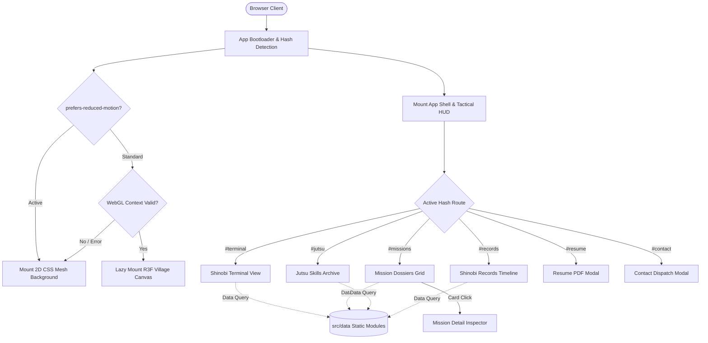

# Technical Requirements Document (TRD)
# SHINOBI OS — Classified Shinobi Intelligence

---

## 1. Document Metadata & Context

| Attribute | Details |
| :--- | :--- |
| **Document Title** | Technical Requirements Document: SHINOBI OS |
| **Document ID** | TRD-SHINOBI-001 |
| **Version** | 1.0.0 (Technical Baseline Specification) |
| **Status** | Approved for Implementation Roadmap & Task Tracking |
| **Last Updated** | 2026-10-10 |
| **Author** | Senior Frontend Architect, Three.js Specialist & Performance Engineer |
| **Primary References** | `SHINOBI-OS/docs/PRD.md` (v1.0.0), `SHINOBI-OS/docs/AppFlow.md` (v1.0.0), `SHINOBI-OS/docs/Design.md` (v1.0.0), `SHINOBI-OS/docs/Schema.md` (v1.0.0) |
| **Repository Path** | `SHINOBI-OS/docs/TRD.md` |

---

## 2. Technical Objectives & Constraints

### 2.1 Engineering Objectives
1. **Uncompromised Portfolio Utility**: Ensure that all professional portfolio data (projects, skills, career history, resume, contact) is accessible in $\le 300\text{ ms}$ on any device, completely decoupled from visual effects or 3D canvas initialization.
2. **Selective & Resilient 3D Canvas**: Deliver a cinematic nighttime village atmosphere using React Three Fiber that gracefully unmounts, degrades, or disables itself based on device capability and accessibility settings.
3. **Zero-Backend Static Architecture**: Execute entirely client-side with zero databases, zero authentication, zero server runtimes, and zero environment secrets.
4. **Predictable Performance**: Target production Lighthouse Performance $\ge 90$, First Contentful Paint (FCP) $\le 1.2\text{s}$, and Interaction to Next Paint (INP) $\le 150\text{ms}$ on standard hardware.

### 2.2 Environmental Constraints
- **Hardware Diversity**: Target low-power mobile devices (e.g. 4GB RAM Android/iOS) up to 4K multi-monitor desktop workstations.
- **Network Variability**: Initial critical portfolio interactive payload must be $\le 200\text{ KB}$ gzipped.
- **Browser Compatibility**: Full functional parity across Chromium ($\ge 110$), Apple Safari ($\ge 16$), Mozilla Firefox ($\ge 110$), and Microsoft Edge ($\ge 110$).

---

## 3. Technology Stack & Architectural Baseline

```
┌────────────────────────────────────────────────────────────────────────┐
│                        CORE TECHNOLOGY STACK                           │
├─────────────────────┬──────────────────────────────────────────────────┤
│ Layer               │ Selected Technology & Architectural Role         │
├─────────────────────┼──────────────────────────────────────────────────┤
│ Core Framework      │ React 19 (Functional Components, Hooks, Suspense) │
│ Type System         │ TypeScript 6 (Strict mode, no implicit any)      │
│ Bundler & Server    │ Vite 8 (Native ES modules, lightning HMR)        │
│ Styling Engine      │ Tailwind CSS v4 (Zero-runtime utility engine)     │
│ Motion Engine       │ Framer Motion 13+ (Kinetic DOM springs & FLIP)   │
│ Iconography         │ Lucide React (Tree-shakeable SVG icons)          │
│ 3D Graphics Engine  │ Three.js via @react-three/fiber & @react-three/drei│
│ Routing Strategy    │ Lightweight Hash-Based Client Router (Zero 404s) │
│ Testing Framework   │ Vitest, React Testing Library, Playwright (E2E)  │
│ Deployment Target   │ Vercel Static Edge CDN (Zero server dependencies) │
└─────────────────────┴──────────────────────────────────────────────────┘
```

### 3.1 Rationale for Key Technology Choices
- **React 19 + TypeScript**: Declarative UI state management and compile-time guarantees preventing null reference errors across portfolio collections.
- **Tailwind CSS v4 (`@tailwindcss/vite`)**: Integrates seamlessly with Vite, eliminates legacy `postcss.config.js` overhead, and compiles theme tokens into native CSS variables.
- **Three.js + React Three Fiber (`R3F`)**: Declarative scene graph management that cleanly decouples canvas lifecycle from standard DOM elements. Isolated in a dedicated `Suspense` boundary.
- **Framer Motion (`motion/react`)**: Handles modal scale transitions, drawer slide-overs, and FLIP layout animations for project filter sorting.
- **Hash-Based Client Routing**: Eliminates single-page application (SPA) routing 404 rewrite pitfalls on static hosts like GitHub Pages or generic CDNs.

---

## 4. System Architecture

```
┌────────────────────────────────────────────────────────────────────────┐
│                        SYSTEM LAYER ARCHITECTURE                       │
├────────────────────────────────────────────────────────────────────────┤
│                           VIEWPORT DOM ROOT                            │
│                                                                        │
│  ┌──────────────────────────────────────────────────────────────────┐  │
│  │ 1. APP SHELL CONTAINER (Router, Hash Listener, Audio Context)    │  │
│  │                                                                  │  │
│  │   ┌──────────────────────────────────────────────────────────┐   │  │
│  │   │ 2. PERSISTENT TACTICAL HUD (Status Bar, Dock, Skip HUD)   │   │  │
│  │   └──────────────────────────────────────────────────────────┘   │  │
│  │                                                                  │  │
│  │   ┌──────────────────────────────────────────────────────────┐   │  │
│  │   │ 3. ACTIVE VIEWPORT STAGE (Z-Index: 10)                   │   │  │
│  │   │   • Terminal Shell         • Jutsu Archive (Skills)      │   │  │
│  │   │   • Mission Dossiers Grid  • Shinobi Records (Timeline)  │   │  │
│  │   └──────────────────────────────────────────────────────────┘   │  │
│  │                                                                  │  │
│  │   ┌──────────────────────────────────────────────────────────┐   │  │
│  │   │ 4. MODAL & INSPECTION OVERLAYS (Z-Index: 100)            │   │  │
│  │   │   • Mission Detail Modal   • Resume PDF Viewer           │   │  │
│  │   │   • Contact Dispatch Form  • Mobile Tactical Drawer      │   │  │
│  │   └──────────────────────────────────────────────────────────┘   │  │
│  └──────────────────────────────────────────────────────────────────┘  │
│                                                                        │
│  ┌──────────────────────────────────────────────────────────────────┐  │
│  │ 5. ISOLATED BACKGROUND CANVAS (Z-Index: 0)                       │  │
│  │   [WebGL Supported] ──▶ React Three Fiber (Misty Night Scene)    │  │
│  │   [Fallback / No GL]──▶ 2D CSS Radial Mesh Vignette             │  │
│  └──────────────────────────────────────────────────────────────────┘  │
│                                                                        │
│  ┌──────────────────────────────────────────────────────────────────┐  │
│  │ 6. STATIC DATA LAYER (Immutable TypeScript Datasets in src/data/)│  │
│  └──────────────────────────────────────────────────────────────────┘  │
└────────────────────────────────────────────────────────────────────────┘
```

### 4.1 Architecture Flow Diagram (Mermaid)



---

## 5. Source Code Directory Structure

The repository maintains strict modularity, clean boundaries, and zero circular dependencies:

```
SHINOBI-OS/
├── docs/                             # Project specifications (PRD, AppFlow, Design, Schema, TRD)
├── public/                           # Static assets served as-is
│   ├── assets/                       # Resume PDF, avatar portraits, textures
│   │   ├── docs/
│   │   │   └── Developer_Resume.pdf
│   │   └── profile/
│   │       └── profile-avatar.webp
│   ├── favicon.svg                   # Shuriken vector favicon
│   └── robots.txt
├── src/
│   ├── assets/                       # Bundled SVGs, vector seal ciphers
│   ├── components/                   # React presentation and container components
│   │   ├── layout/                   # HUD dock, top status bar, tactical shell
│   │   │   ├── AppShell.tsx
│   │   │   ├── TopStatusBar.tsx
│   │   │   └── TacticalDock.tsx
│   │   ├── portfolio/                # Core portfolio views
│   │   │   ├── AwakeningIntro.tsx    # Cinematic boot sequence
│   │   │   ├── TerminalView.tsx      # Interactive command shell
│   │   │   ├── MissionsView.tsx      # Project grid & filter bar
│   │   │   ├── MissionDetailModal.tsx# In-depth project inspector
│   │   │   ├── JutsuView.tsx         # Technical skills quadrant
│   │   │   ├── RecordsView.tsx       # Experience & education timeline
│   │   │   ├── ResumeModal.tsx       # ATS resume viewer & download
│   │   │   └── ContactModal.tsx      # Contact dispatch modal
│   │   ├── scene/                    # Isolated Three.js / R3F Canvas components
│   │   │   ├── ShinobiScene.tsx      # Canvas wrapper & fallback boundary
│   │   │   ├── NightAtmosphere.tsx   # Fog, moonlight, and lighting
│   │   │   └── FloatingLeaves.tsx    # Throttled particle mesh
│   │   └── ui/                       # Reusable micro-components
│   │       ├── Button.tsx
│   │       ├── Badge.tsx
│   │       ├── Card.tsx
│   │       ├── Modal.tsx
│   │       └── Tooltip.tsx
│   ├── context/                      # Global UI contexts
│   │   ├── RouterContext.tsx         # Hash router & navigation state
│   │   ├── AudioContext.tsx          # Web Audio procedural synthesizer
│   │   └── ThemeContext.tsx          # Color accent & terminal state
│   ├── data/                         # Static typed datasets (from Schema.md)
│   │   ├── profile.ts
│   │   ├── projects.ts
│   │   ├── skills.ts
│   │   ├── timeline.ts
│   │   ├── siteConfig.ts
│   │   └── index.ts                  # Barrel export & query helpers
│   ├── hooks/                        # Custom React hooks
│   │   ├── useHashRoute.ts           # Listens to window.location.hash
│   │   ├── useAudioSynth.ts          # Procedural sound effect triggers
│   │   ├── useKeyboardShortcuts.ts   # Alt+1..6 dock shortcuts & Escape
│   │   └── useReducedMotion.ts       # Query prefers-reduced-motion
│   ├── styles/                       # Global styling & Tailwind tokens
│   │   └── index.css                 # Theme variables & base typography
│   ├── types/                        # TypeScript type definitions (from Schema.md)
│   │   ├── schema.ts                 # Profile, Project, Skill, Experience
│   │   └── navigation.ts             # Route keys & UI states
│   ├── utils/                        # Pure utility functions
│   │   ├── terminalCommands.ts       # Command parser (help, clear, projects)
│   │   ├── soundSynth.ts             # Web Audio oscillator primitives
│   │   └── formatters.ts             # Date and string formatters
│   ├── App.tsx                       # Root view orchestrator
│   └── main.tsx                      # Vite React 19 bootstrap
├── tests/                            # Test suites
│   ├── unit/                         # Unit tests (commands, formatters, schema)
│   ├── components/                   # RTL component interaction tests
│   └── setup.ts                      # Vitest test configuration
├── index.html                        # HTML entry point with preload tags
├── package.json                      # Scripts and dependencies
├── tsconfig.json                     # TypeScript solution config
├── tsconfig.app.json                 # Application TS options
├── tsconfig.node.json                # Vite tooling TS options
└── vite.config.ts                    # Vite plugins & build optimization
```

---

## 6. Application Entry, Hash Routing & Navigation

### 6.1 Hash-Based Navigation Engine
To guarantee zero-configuration deployment across static edge CDNs without 404 rewrite rules, SHINOBI OS implements a lightweight, reactive **Hash Router Hook** (`useHashRoute`):

```typescript
export type RouteKey = 
  | 'awakening' 
  | 'terminal' 
  | 'missions' 
  | 'jutsu' 
  | 'records' 
  | 'resume' 
  | 'contact';

export interface RouteState {
  route: RouteKey;
  subParam?: string; // e.g., 'samvad' in #missions/samvad
}
```

- **Hash Change Listener**: Listens to `window.addEventListener('hashchange', ...)` and parses the current hash.
- **Deep-Link Support**: Navigating to `/#missions/sports-gear` automatically mounts the `missions` view and opens the `sports-gear` detail modal.
- **History Navigation**: Standard `window.history.pushState` maintains natural browser Back and Forward button navigation.
- **Fallback on Unknown Routes**: If a visitor enters `/#invalid-hash`, the router smoothly falls back to `#terminal` without throwing runtime errors.

### 6.2 Awakening Intro Skip & Replay Lifecycle
- **Skip Persistence**: Stored in `localStorage.getItem('shinobi_intro_bypassed')`.
- **First Visit**: If flag is absent and motion is standard $\rightarrow$ defaults to `#awakening`.
- **Revisit**: If flag is `'true'` or deep link is provided $\rightarrow$ immediately routes to `#terminal` or target section.
- **Replay Action**: User clicking `[Replay Awakening]` in the status bar forces route to `#awakening`.

---

## 7. Content & Data Layer Architecture

1. **Immutable In-Memory Datasets**: All data resides in `src/data/*.ts` files importing interfaces from `src/types/schema.ts`.
2. **Deterministic Lookup Queries**:
   - `getFeaturedProjects()`: Filters `projects.filter(p => p.featured)`.
   - `getProjectsByRank(rank)`: Filters by `missionRank`.
   - `getSkillsByDiscipline(discipline)`: Groups skills for quadrant rendering.
3. **Resilient Field Handling**:
   - Every optional property (`metrics`, `galleryAssets`, `problemStatement`) is checked with optional chaining (`project.metrics?.length`).
   - If a project link is omitted, the UI omits the button rather than generating a broken `href="#"`.

---

## 8. 3D Rendering Architecture (React Three Fiber)

```
┌────────────────────────────────────────────────────────────────────────┐
│                   REACT THREE FIBER ISOLATION LAYER                    │
├────────────────────────────────────────────────────────────────────────┤
│ <ShinobiScene> Container                                               │
│   ├── 1. Suspense Fallback ──▶ CSS Radial Mesh (Instant rendering)     │
│   ├── 2. Error Boundary    ──▶ Catches WebGL crash / context loss      │
│   └── 3. <Canvas> Component (R3F)                                      │
│            ├── Performance Monitor (Adaptive scaling if FPS < 50)      │
│            ├── PerspectiveCamera (FOV: 45, Position: [0, 2, 8])        │
│            ├── Directional Moonlight (#94A3B8, Intensity: 0.6)         │
│            ├── Ambient Fog (#07080C, Near: 6, Far: 18)                 │
│            └── InstancedMesh (Floating Leaves / Embers: Max 35 instances│
└────────────────────────────────────────────────────────────────────────┘
```

### 8.1 3D Isolation & Graceful Degradation
- **Strict Decoupling**: The 3D scene lives strictly in `src/components/scene/`. The portfolio UI operates independently and renders immediately regardless of whether Three.js has initialized.
- **Dynamic Lazy Loading**: `ShinobiScene` is dynamically imported via `React.lazy()` so the initial HTML/DOM bundle loads without waiting for Three.js script evaluation:
  ```typescript
  const ShinobiScene = React.lazy(() => import('@/components/scene/ShinobiScene'));
  ```
- **Context Loss Recovery**: Attaches an event listener to `webglcontextlost`. Upon context loss, the component cleanly unmounts the `<Canvas>` and renders the 2D CSS mesh gradient fallback.
- **Mobile & Reduced Motion**:
  - If `window.innerWidth < 768` or `prefers-reduced-motion` is detected, the Canvas is not mounted at all, preserving battery life and mobile memory.

---

## 9. Performance Engineering Strategy

### 9.1 Verification Targets

| Metric | Target | Verification Method |
| :--- | :--- | :--- |
| **Lighthouse Desktop Performance** | $\ge 90$ | Chrome DevTools Lighthouse audit in production build |
| **Largest Contentful Paint (LCP)** | $\le 2.0\text{ s}$ | High-priority font & logo preload; fast DOM hydration |
| **Interaction to Next Paint (INP)** | $\le 100\text{ ms}$ | Zero heavy JavaScript blocking the main thread |
| **Cumulative Layout Shift (CLS)** | $\le 0.05$ | Explicit aspect ratios and skeleton containers |
| **Production Core Bundle Size** | $\le 180\text{ KB}$ gzip | Rollup visualizer audit excluding dynamic 3D chunk |

### 9.2 Build Optimization & Code-Splitting in `vite.config.ts`
Vite is configured with granular Rollup chunk splitting to ensure that visitors who only inspect the resume or terminal do not download the 3D engine up front:

```typescript
// Proposed rollupOptions.output.manualChunks
manualChunks(id) {
  if (id.includes('node_modules/three') || id.includes('node_modules/@react-three')) {
    return 'vendor-three';
  }
  if (id.includes('node_modules/framer-motion')) {
    return 'vendor-motion';
  }
  if (id.includes('node_modules/lucide-react')) {
    return 'vendor-lucide';
  }
}
```

### 9.3 Asset & Font Optimization
- **Self-Hosted WOFF2 Fonts**: Font files are stored locally in `public/fonts/` with `font-display: swap`. Preloaded in `index.html` with `<link rel="preload" as="font" type="font/woff2" crossorigin>`.
- **Modern Image Formats**: All thumbnails and avatar portraits formatted as optimized WebP or SVG ($\le 60\text{ KB}$ each).

---

## 10. Animation Architecture (Framer Motion & CSS)

### 10.1 Division of Animation Responsibilities
- **CSS Transitions**: Micro-interactions, button hover states, focus rings, border glows, and tab indicators ($100\text{ms} - 180\text{ms}$).
- **Framer Motion (`motion/react`)**:
  - Modal entrances (`scale: 0.95 -> 1.0`, `opacity: 0 -> 1`).
  - Mobile bottom-drawer slide-overs (`y: '100%' -> '0%'`).
  - Staggered card entrance lists.
  - FLIP card rearrangement during category filter changes.

### 10.2 Reduced-Motion Implementation
A custom hook `useReducedMotion()` listens to `(prefers-reduced-motion: reduce)`. When active:
- Framer Motion sets `transition={{ duration: 0 }}`.
- All CSS animations are clamped via utility `@media (prefers-reduced-motion: reduce) { * { animation-duration: 0.01ms !important; } }`.

---

## 11. Accessibility Architecture (WCAG 2.2 AA)

1. **Semantic HTML Foundations**:
   - Navigation wrapped in `<nav aria-label="Tactical HUD Navigation">`.
   - Project cards structured as semantic `<article>` items with structured headings (`<h3>`).
   - Terminal log tagged with `role="log"` and `aria-live="polite"`.
2. **Keyboard Focus & Modal Trap**:
   - Modals use the standard WAI-ARIA dialog pattern (`role="dialog"`, `aria-modal="true"`, `aria-labelledby`).
   - Focus is automatically trapped within the active modal; pressing `Escape` closes the modal and returns focus to the trigger button.
3. **High-Contrast Visible Focus Rings**:
   - All interactive elements exhibit an active focus ring (`outline: 2px solid #10B981; outline-offset: 2px`).

---

## 12. Security & Privacy Architecture

1. **Client-Side Sanitization**: Terminal inputs are parsed strictly via whitelisted commands and string comparisons. User input is never evaluated via `eval()` or injected via `dangerouslySetInnerHTML`.
2. **External Link Safety**: All external anchor tags (GitHub, LinkedIn, live demos) strictly include `target="_blank" rel="noopener noreferrer"`.
3. **No Embedded Secrets**: The repository contains zero API keys, private tokens, or backend credentials.
4. **Zero Third-Party Trackers**: No invasive tracking scripts, cookies, or user telemetry cookies.

---

## 13. Error Handling & Resilience

| Potential Failure Point | System Handling & Graceful Degradation |
| :--- | :--- |
| **WebGL Fails to Initialize** | `ShinobiScene` error boundary catches failure and mounts the 2D CSS mesh gradient without runtime errors. |
| **Missing Resume PDF Asset** | Resume button detects `resumeConfig.isAvailable === false` and renders an in-browser readable summary with status `"Under Revision"`. |
| **Missing Project Image** | Card renders a sleek fallback SVG monogram with the project codename. |
| **Invalid Deep Link (#missions/404)**| Router detects unmapped slug, notifies the user via terminal notification, and renders the standard `#missions` overview. |
| **Audio Playback Blocked** | Browser autoplay policy is respected; audio remains completely muted until explicit user interaction with the audio toggle. |

---

## 14. Testing Strategy

```
┌────────────────────────────────────────────────────────┐
│                    TESTING PYRAMID                     │
├────────────────────────────────────────────────────────┤
│ E2E Journeys (Playwright)                              │
│ • Recruiter fast-track journey (Skip -> Resume -> DL)  │
│ • Keyboard navigation through terminal and modal traps │
├────────────────────────────────────────────────────────┤
│ Component & Integration Tests (Vitest + RTL)           │
│ • Terminal input parser and command dispatching        │
│ • Mission filtering by rank and keyword search         │
│ • Modal mount, focus trap, and Escape dismissal        │
├────────────────────────────────────────────────────────┤
│ Unit & Schema Tests (Vitest)                           │
│ • Content schema validation (All IDs unique, valid URIs│
│ • Pure formatters, date ordering, and sound synth      │
├────────────────────────────────────────────────────────┤
│ Static Analysis & Type Checking                        │
│ • tsc --noEmit (Strict TypeScript check)               │
│ • oxlint / ESLint code quality checks                  │
└────────────────────────────────────────────────────────┘
```

---

## 15. Deployment & Environment Strategy

- **Build Command**: `npm run build` (`tsc -b && vite build`).
- **Dev Command**: `npm run dev` (Vite development server on `http://localhost:5173`).
- **Static Hosting**: Configured for instant deployment to Vercel, GitHub Pages, or Netlify with zero environment variables (`.env`).
- **Static Headers**: Security headers (`X-Content-Type-Options: nosniff`, `X-Frame-Options: DENY`, `Referrer-Policy: strict-origin-when-cross-origin`) applied via `vercel.json`.

---

## 16. Technical Decision Register

| Decision Area | Technical Recommendation | Technical Rationale | Alternatives Considered | Status |
| :--- | :--- | :--- | :--- | :--- |
| **Routing** | Hash-Based Router (`#route`) | Eliminates SPA 404 rewrite issues on static edge CDNs. | React Router (History API), Wouter | **Confirmed** |
| **3D Rendering** | React Three Fiber (Lazy Loaded) | Declarative scene graph, cleanly isolated in Suspense. | Vanilla Three.js, Pure Canvas 2D | **Confirmed** |
| **Styling** | Tailwind CSS v4 (`@tailwindcss/vite`)| Direct Vite integration, zero-runtime, modern `@theme`. | Vanilla CSS, CSS Modules | **Confirmed** |
| **Animation** | Framer Motion (`motion/react`) | Native gesture support, FLIP layout animations, springs. | GSAP, Anime.js | **Confirmed** |
| **Iconography** | Lucide React | Lightweight tree-shakeable SVG vector components. | Heroicons, FontAwesome | **Confirmed** |
| **Audio FX** | Web Audio API (Oscillators) | Zero-byte external assets; procedural keyclicks. | MP3 audio files in `/public` | **Confirmed** |
| **Testing** | Vitest + RTL + Playwright | Fast native Vite test runner with real DOM emulation. | Jest, Cypress | **Confirmed** |

---

## 17. Technical Acceptance Criteria

- [ ] **Strict Compilation**: Project builds cleanly with `npm run build` with zero TypeScript errors under strict mode.
- [ ] **Lighthouse Performance Target**: Achieves $\ge 90$ Performance score on desktop audits in production mode.
- [ ] **Accessibility Compliance**: Meets WCAG 2.2 AA standards with verified keyboard navigation and contrast ratios $\ge 4.5:1$.
- [ ] **Resilient 3D Fallback**: Renders cleanly when hardware acceleration or WebGL is disabled without uncaught exceptions.
- [ ] **Zero 404 Routing**: Hash routes (`/#missions`, `/#records`, `/#resume`) load reliably without server redirects.
- [ ] **Zero Backend Dependencies**: Fully functional as a static export on Vercel or GitHub Pages.

---

## 18. Open Technical Questions & Implementation Flags

The following implementation-specific nuances are flagged for tracking in `ImplementationPlan.md`:
1. **Testing Runner Setup**: Finalizing the Vitest configuration (`vitest.config.ts`) and test script definitions in `package.json` when test implementation begins.
2. **Audio Volume Normalization**: Ensuring Web Audio API gain nodes are capped at low volume ($\le 0.05$ gain) to prevent harsh speaker pops.

---
*End of Technical Requirements Document — SHINOBI OS*
