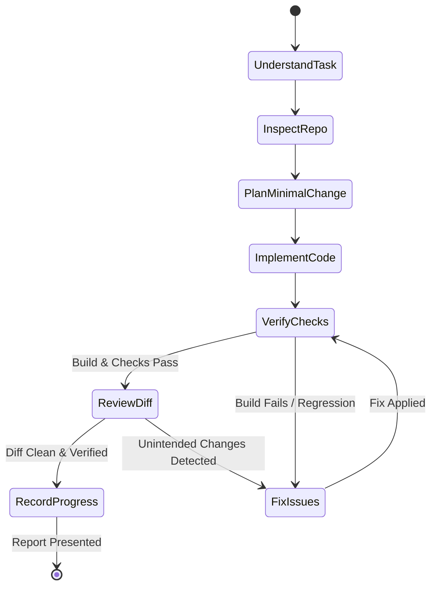
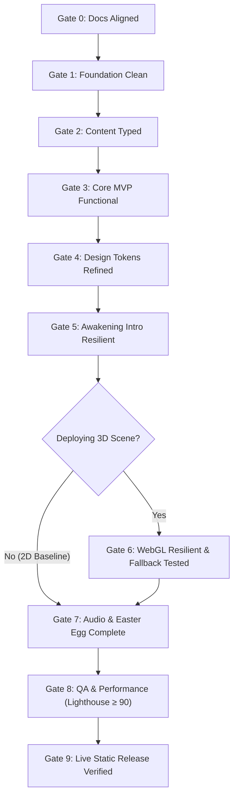

# Development Workflow & Execution Protocol
# SHINOBI OS — Classified Shinobi Intelligence

---

## 1. Document Metadata & Context

| Attribute | Details |
| :--- | :--- |
| **Document Title** | Development Workflow & Execution Protocol: SHINOBI OS |
| **Document ID** | WORKFLOW-SHINOBI-001 |
| **Version** | 1.0.0 (Standard Operating Procedure Baseline) |
| **Status** | Active Enforcement (Operational guide for developers & AI assistants) |
| **Last Updated** | 2026-10-10 |
| **Author** | Senior Engineering Manager & AI-Assisted Workflow Architect |
| **Primary References** | `docs/PRD.md`, `docs/AppFlow.md`, `docs/Design.md`, `docs/Schema.md`, `docs/TRD.md`, `docs/AssetManifest.md`, `docs/ImplementationPlan.md`, `docs/Rules.md` |
| **Repository Path** | `SHINOBI-OS/docs/Workflow.md` |

---

## 2. Core Workflow Principles

To maximize engineering velocity while eliminating regressions, hallucinations, and code bloat in AI-assisted development, all development must adhere to these four core tenets:

1. **Small, Atomic, Reviewable Changes**: Every task touches the minimum viable set of files required to deliver a specific, testable outcome. Monolithic one-shot code generations are strictly prohibited.
2. **Authoritative Specification Anchoring**: Every line of code written must trace directly to requirements in `PRD.md`, interactions in `AppFlow.md`, visual tokens in `Design.md`, or interfaces in `Schema.md`.
3. **Evidence-Based Verification**: A feature is never declared "working" based on assumptions. Actual terminal build output, TypeScript compile logs, or test execution proofs are mandatory.
4. **Preservation of the Working Baseline**: Each step must leave the repository in a clean, buildable, deployable state. If a change breaks previously verified functionality, it must be fixed or reverted before proceeding.

---

## 3. Standard Task Lifecycle (Mandatory 8-Step Loop)

Every implementation task must execute through this rigorous 8-step lifecycle:

```
┌────────────────────────────────────────────────────────┐
│               STANDARD TASK LIFECYCLE                  │
├────────────────────────────────────────────────────────┤
│ 1. UNDERSTAND ──▶ Identify task scope & requirements   │
│ 2. INSPECT    ──▶ Check repository state & diffs       │
│ 3. PLAN       ──▶ Formulate minimal coherent change    │
│ 4. IMPLEMENT  ──▶ Write targeted code & fallbacks      │
│ 5. VERIFY     ──▶ Run builds, type checks & tests      │
│ 6. REVIEW     ──▶ Audit git diff & check regressions   │
│ 7. FIX        ──▶ Resolve any defects immediately      │
│ 8. RECORD     ──▶ Update Tracker & report evidence     │
└────────────────────────────────────────────────────────┘
```

### Step 1 — Understand
- Identify the explicit task ID from `ImplementationPlan.md` (e.g. `IMP-010`).
- Cross-reference applicable functional requirements (`FR-xxx`), design tokens, and schema types.
- Identify any unconfirmed assumptions and document them before writing code.

### Step 2 — Inspect
- Examine the existing project directory and target source files using file inspection tools (`view_file`).
- Verify installed packages and script definitions in `package.json`.
- Execute `git status` to verify the working tree is clean. **Never assume a directory is empty or safe to overwrite.**

### Step 3 — Plan
- Formulate the smallest coherent implementation plan.
- Explicitly list the target files to create or modify.
- Define testable acceptance criteria and identify potential regression vectors.

### Step 4 — Implement
- Make targeted, surgical edits using precise code modification tools (`replace_file_content` or `write_to_file`).
- Adhere strictly to `Rules.md`: strict TypeScript, no hardcoded content in JSX, semantic design tokens.
- Implement appropriate loading, empty, error, and fallback states alongside primary view logic.

### Step 5 — Verify
- Execute type checking (`tsc -b`) and production build tests (`npm run build`).
- Verify component rendering and interactions on simulated desktop ($1200\text{px}$) and mobile ($375\text{px}$) viewports.
- Check console logs for unhandled exceptions or React hydration warnings.

### Step 6 — Review
- Execute `git diff` to inspect every modified line.
- Confirm that no unrelated files, temporary logs, or accidental changes were introduced.
- Verify that previous capabilities remain functional.

### Step 7 — Fix
- If any build error, lint violation, or visual defect is discovered, resolve it immediately before proceeding.
- Re-run verification commands to confirm the fix succeeded.

### Step 8 — Record
- Update task status in `docs/Tracker.md` with timestamp and verification evidence.
- Present a structured completion report detailing files modified and test results.

---

## 4. Workflow Modes & Targeted Verification

Different types of development require specialized verification protocols:

| Workflow Mode | Typical Triggers | Mandatory Verification Checks |
| :--- | :--- | :--- |
| **1. New Feature** | Building a new view or component (`TerminalView`, `MissionsView`) | Type check (`tsc`), production build (`npm run build`), responsive check ($375\text{px}$ & $1200\text{px}$), keyboard focus verification. |
| **2. Visual Polish** | Refining typography, colors, borders, or layout margins | Contrast ratio audit ($\ge 4.5:1$), cross-device visual check, verifying no hardcoded arbitrary hex values. |
| **3. Bug Fixing** | Resolving broken interaction, layout glitch, or console error | Targeted regression test, verifying the specific defect is eliminated without altering unrelated logic. |
| **4. Performance** | Optimizing bundle size, asset loading, or animation FPS | DevTools bundle analysis, verifying core bundle remains $\le 180\text{ KB}$ gzip, measuring before/after metrics. |
| **5. Accessibility** | Improving keyboard navigation, ARIA labels, or focus traps | Keyboard-only walkthrough (`Tab`, `Escape`), screen reader live region verification, reduced-motion clamp check. |
| **6. Dependency** | Adding or upgrading an approved package | Dependency audit (`npm audit`), verifying build footprint, checking package compatibility. |
| **7. Asset Ingestion** | Adding project thumbnail, avatar, or vector emblem | Verifying WebP format ($\le 65\text{ KB}$), verifying license in `AssetManifest.md`, testing missing-asset fallback. |
| **8. Documentation**| Updating architecture specs, tracker, or plans | Cross-document consistency review; verifying no implementation code or dependencies were touched. |
| **9. Release / Deploy**| Staging production build to edge CDN (Vercel / GitHub Pages) | Link crawler verification (zero broken links), Lighthouse audit ($\ge 90$), cross-browser verification. |

---

## 5. Phase Gates & Progression Criteria

Progress through the delivery roadmap follows the 9 mandatory quality gates defined in `ImplementationPlan.md`:

```
┌────────────────────────────────────────────────────────────────────────┐
│                        SEQUENTIAL PHASE GATES                          │
├────────────────────────────────────────────────────────────────────────┤
│ Gate 0: Specs Aligned    ──▶ All 6 specification documents synchronized │
│ Gate 1: Foundation Clean ──▶ Build pipeline compiles cleanly with Vite  │
│ Gate 2: Content Typed    ──▶ TypeScript schemas and static data verified│
│ Gate 3: MVP Functional   ──▶ Complete portfolio works without 3D/audio  │
│ Gate 4: Design Complete  ──▶ Semantic tokens & mobile drawers refined   │
│ Gate 5: Intro Resilient  ──▶ Awakening plays, skips instantly on Escape │
│ Gate 6: WebGL Resilient  ──▶ 3D lazy-loads; 2D CSS mesh fallback tested │
│ Gate 7: Feature Complete ──▶ Web Audio & ANBU Easter egg integrated    │
│ Gate 8: Release Ready    ──▶ Lighthouse ≥ 90, zero console exceptions  │
│ Gate 9: Live Verified    ──▶ Production deployment verified on live web │
└────────────────────────────────────────────────────────────────────────┘
```

**Golden Gate Rule**: Phase 6 (3D Scene) cannot begin until Gate 3 (MVP Functional) is fully signed off. The developer portfolio must be completely functional and verified before any 3D development commences.

---

## 6. Definition of Ready (DoR) & Definition of Done (DoD)

### 6.1 Definition of Ready (DoR)
A task can begin implementation **only when**:
- [ ] Task scope is clearly defined with an assigned ID in `ImplementationPlan.md`.
- [ ] Upstream dependencies from previous phases have passed their respective quality gates.
- [ ] Target data schemas or design tokens are fully specified in `Schema.md` or `Design.md`.
- [ ] The existing working tree is clean with zero uncommitted or broken code.

### 6.2 Definition of Done (DoD)
A task is considered complete **only when**:
- [ ] Requested functional behavior matches acceptance criteria.
- [ ] TypeScript compilation (`tsc -b`) succeeds with zero errors under strict mode.
- [ ] Production build (`npm run build`) exits with code 0.
- [ ] Responsive behavior verified on mobile ($375\text{px}$) and desktop ($1200\text{px}$).
- [ ] Fallback states (empty data, missing images, WebGL loss) function gracefully.
- [ ] `git diff` confirms zero unintended modifications or console debugging statements.
- [ ] Task progress is recorded in `docs/Tracker.md`.

---

## 7. Verification Matrix

| Target Component / Scope | TypeScript Check | Production Build | Responsive Check | Keyboard & A11Y | Fallback Test | Diff Inspection |
| :--- | :---: | :---: | :---: | :---: | :---: | :---: |
| **Static Content (`src/data/`)** | Mandatory | Mandatory | Optional | Optional | Mandatory | Mandatory |
| **Navigation & Router (`AppShell`)** | Mandatory | Mandatory | Mandatory | Mandatory | Mandatory | Mandatory |
| **UI Components (`Button`, `Card`)** | Mandatory | Mandatory | Mandatory | Mandatory | Optional | Mandatory |
| **Terminal Shell (`TerminalView`)** | Mandatory | Mandatory | Mandatory | Mandatory | Mandatory | Mandatory |
| **Mission Dossiers (`MissionsView`)**| Mandatory | Mandatory | Mandatory | Mandatory | Mandatory | Mandatory |
| **3D Scene (`ShinobiScene`)** | Mandatory | Mandatory | Mandatory | Mandatory | Mandatory | Mandatory |
| **Media Assets (`/public/assets/`)** | Optional | Mandatory | Mandatory | Mandatory | Mandatory | Mandatory |
| **Documentation (`/docs/`)** | Optional | Optional | Optional | Optional | Optional | Mandatory |

---

## 8. Failure & Recovery Procedures

When encountering an implementation failure, developers and assistants must execute this structured diagnostic protocol:

```
┌────────────────────────────────────────────────────────┐
│             FAILURE & RECOVERY PROTOCOL                │
├────────────────────────────────────────────────────────┤
│ [FAILURE ENCOUNTERED: Build Error / Test Breakage]     │
│       │                                                │
│       ▼                                                │
│ 1. DIAGNOSE FIRST: Read exact error log & stack trace  │
│       │                                                │
│       ▼                                                │
│ 2. ISOLATE CAUSE: Identify exact line & file modified   │
│       │                                                │
│       ├── Can be fixed with small targeted edit?       │
│       │   ──▶ YES ──▶ Apply minimal fix & re-verify    │
│       │                                                │
│       └── Complex regression or corrupt tree?          │
│           ──▶ NO  ──▶ Revert dirty files via git       │
│                       restore; restore last known      │
│                       working baseline; report blocker │
└────────────────────────────────────────────────────────┘
```

1. **Build / TypeScript Compilation Failure**:
   - Inspect terminal output to identify the exact file and line number.
   - Fix type definitions or import paths directly. **Never disable `strict` type checking or insert `any` casts as a shortcut.**
2. **WebGL Crash / 3D Canvas Context Loss**:
   - Verify that the canvas Error Boundary catches the error and unmounts the canvas.
   - Confirm that the procedural 2D CSS mesh gradient mounts immediately without white-screen crashes.
3. **Accidental Modification of Unrelated Files**:
   - Immediately execute `git restore <unrelated-file>` to discard changes.
   - Re-run `git status` to verify working tree cleanliness.

---

## 9. Git & Change-Management Workflow

1. **Pre-Work Health Check**:
   - Always run `git status` before beginning work to ensure clean working directory.
2. **Atomic Task Commits**:
   - Commit only after a task's verification criteria have been satisfied.
   - Conventional commit message format: `<type>(<scope>): <action>` (e.g., `feat(terminal): implement command history and auto-complete`).
3. **Safe Reversion**:
   - Never use destructive resets (`git reset --hard`) that could destroy working documentation or uncommitted progress without explicit authorization.

---

## 10. Performance Optimization Workflow

When executing performance tuning tasks (Phase 8), follow this rigorous 6-step loop:

1. **Establish Baseline**: Run `npm run build` and measure production asset bundle sizes and Lighthouse Performance metrics.
2. **Profile Bottleneck**: Use Chrome DevTools Performance panel or Rollup bundle visualizer to pinpoint the exact heavy chunk or blocking script.
3. **Execute Targeted Optimization**: Apply a single focused optimization (e.g. dynamic import for R3F, font preloading, SVG path minification).
4. **Re-Measure Under Identical Conditions**: Re-run the exact build and audit command.
5. **Verify Zero Functional Regression**: Confirm that visual appearance, layout stability, and interactivity remain 100% intact.
6. **Record Benchmark Data**: Log the before/after numbers in `Tracker.md`.

---

## 11. Documentation Synchronization Protocol

To ensure documentation never drifts from working code, the following sync triggers are enforced:

| Documentation File | Trigger for Synchronization | Required Update Action |
| :--- | :--- | :--- |
| `docs/Tracker.md` | Task completion or blocker encountered | Update task status checkmark, completion date, and test evidence |
| `docs/ImplementationPlan.md`| Milestone phase completion gate reached | Mark phase complete and record any deferred items |
| `docs/AssetManifest.md` | New media asset ingested | Update asset inventory row from `Planned` to `Active` with file size |
| `docs/TRD.md` | Fundamental architecture adjustment | Record technical decision amendment with rationale |

---

## 12. Mandatory Antigravity Task-Report Format

At the conclusion of every implementation step, the AI assistant must present a structured report matching this format:

```markdown
### Task Completion Report: [Task ID - Task Name]

- **Status**: [Completed | Partially Completed | Blocked | Unverified]
- **Implemented Scope**: [Concise summary of what was built or modified]
- **Files Touched**:
  - `path/to/file1.tsx` (Description of change)
  - `path/to/file2.ts` (Description of change)
- **Verification Evidence**:
  - Command run: `npm run build`
  - Output: `✓ built in 420ms (0 errors)`
  - Browser checks: Desktop (1200px) OK, Mobile (375px) OK
- **Regressions Audited**: [Verified existing views remain 100% functional]
- **Known Limitations / Notes**: [Any open questions or deferred sub-tasks]
- **Next Logical Step**: [Next task from ImplementationPlan.md]
```

*Strict Rule*: The assistant must never claim tests or builds passed without displaying the actual command invocation and output.

---

## 13. Visual Workflow Diagrams (Mermaid)

### 13.1 Task Lifecycle State Machine


### 13.2 Implementation Phase Gates Flow


---

## 14. Workflow Acceptance Criteria

- [ ] **Repeatable & Predictable**: The 8-step task lifecycle provides a clear, uniform structure for every engineering task.
- [ ] **Evidence-Driven**: Every task requires real command execution evidence before sign-off.
- [ ] **Regression-Proof**: Standardized inspection and diff review prevent unintended file modifications.
- [ ] **Aligned with Architecture**: The workflow honors the priorities established across `PRD.md`, `AppFlow.md`, `Design.md`, `Schema.md`, `TRD.md`, and `Rules.md`.
- [ ] **Protective of Core Portfolio**: Ensures core developer portfolio functionality is verified and protected before optional 3D or cinematic enhancements are layered on.

---
*End of Development Workflow & Execution Protocol — SHINOBI OS*
